# Plan maestro del backlog 2026-11

Índice, orden de ejecución y protocolo de las 7 secciones de análisis. Rutas y líneas de las secciones verificadas contra `main` en `5f6b05b4`. Total: 37 cambios. Versión integrada con la revisión cruzada de las 7 sesiones (ver «Registro de revisión»).

## 1. Propósito y reglas de uso

- Este plan es la fuente de verdad del backlog. Cada sección (`01`…`07`) define sus cambios con id estable `C-NN-x`: objetivo, decisiones literales, carril, tamaño, dependencias, ficheros, criterio de terminado y riesgos.
- Cada sesión hija lee su cambio completo en la sección correspondiente antes de empezar. Las decisiones de las secciones son vinculantes y no se reabren sin el usuario. Lo que una sección marca como no confirmado se trata en el apartado 6 y no se decide por cuenta propia. **Las resoluciones del apartado 6.2 prevalecen sobre el texto de las secciones**: antes de empezar, la sesión hija lee el 6.2 y aplica las que afecten a su cambio.
- Push, PR y merge los decide el usuario. Ninguna sesión hace `git push`, abre PR ni fusiona sin orden expresa. Nunca `--fetch` sin autorización.
- Cada cambio se trabaja en un worktree propio, desde la primera escritura:
  `powershell.exe -NoProfile -ExecutionPolicy Bypass -File scripts/axiom-worktree.ps1 new <slug> -Lane odd|sdd`
  PR: `... pr <slug> -Lane odd|sdd`. Tras el merge: `... done <slug> -Lane odd|sdd`. El checkout `C:\repos\axiom` es solo lectura y siempre está en `main`.
- Entrega: **una sola PR por cambio**, con la etiqueta `size:exception` cuando pase de 400 líneas **mientras exista el check de CI**. C-02-e (ola 5) lo elimina y desde entonces la etiqueta deja de usarse (así que C-03-e, ola 9, no la necesita). Nunca PR encadenadas. Dentro de la PR, un commit por unidad de trabajo (convención del repo, sin atribución de IA).
- No compilar binarios sueltos de `axiom` (el EDR los borra): los arneses y las comprobaciones se ejecutan en proceso con `go test`. `go test ./internal/cli/` entero ya no cabe de una vez: trocear por paquetes o `-run`.
- Hasta que C-03-c esté fusionado, no se adopta ningún proyecto real con `axiom archive adopt`: hoy `adopt check` exige `REQ-n.m` (`internal/adoption/adoptcheck/check.go:147-148`) y obligaría a migrar dos veces (regla A-03-2).
- Si una sesión hija encuentra una contradicción con su sección o con otra, se detiene y avisa a la padre. No la resuelve.

## 2. Catálogo

Tamaños: S, M, L, XL. «(blanda)» = dependencia de la que la sección dice «conviene» o que declara blanda; «(inf.)» = inferida al cruzar secciones (ver apartado 3); «P*» = decisión del usuario pendiente (apartado 6). Los enlaces apuntan al fichero; el id se localiza dentro.

| Id | Título | Sección | Carril | Tam. | Depende de | Slug |
|---|---|---|---|---|---|---|
| C-01-a | Hook del preflight valida por etiqueta, no por posición | [01](01-poda-friccion.md) | ODD | S | — | `hook-preflight-etiqueta` |
| C-01-b | Preflight y sellado derivados de la topología (hybrid fijo, multirepo checkpointed, monorepo solo fullstack) | [01](01-poda-friccion.md) | SDD | M | C-01-a; P10 (diseño del hook) | `preflight-topologia` |
| C-01-c | RDD apagado de fábrica y sin posibilidad de activarlo (incluye `routing.go:77`, `:129`, `:131`, `:152-166`) | [01](01-poda-friccion.md) | ODD | S-M | — | `rdd-apagado` |
| C-01-d | Quitar Serena | [01](01-poda-friccion.md) | ODD (P9) | S-M | — | `quitar-serena` |
| C-01-e | Retirada completa de RDD (al final del plan) | [01](01-poda-friccion.md) | SDD | XL | C-01-c | `retirar-rdd` |
| C-02-a | Promoción por repositorio y por cambio (`branch`\|`release`\|`ask`) | [02](02-entrega-git.md) | SDD | L | — | `promocion-ramas` |
| C-02-b | Verificación conjunta del cambio antes de la PR a la rama principal | [02](02-entrega-git.md) | SDD | M | C-02-a | `verify-conjunto` |
| C-02-c | Una sola PR por defecto y retirada del umbral de 400 | [02](02-entrega-git.md) | SDD | L | C-01-a, C-01-b; C-01-c (blanda); P10, P5 | `single-pr` |
| C-02-d | Aviso por commit, parada opcional por tarea, validación al pedir la PR | [02](02-entrega-git.md) | SDD | M | C-02-c; P1, P2 | `aviso-commit` |
| C-02-e | Eliminar el check de tamaño de PR del CI del repo | [02](02-entrega-git.md) | ODD | S | C-02-c (blanda) | `quitar-check-400` |
| C-03-a | Puerto único de IDs de requisito y patrón declarado por proyecto | [03](03-openspec-unica.md) | SDD | L | — | `puerto-reqid` |
| C-03-b | IDs provisionales, número al integrar, impacto en `status` | [03](03-openspec-unica.md) | SDD | L | C-03-a | `ids-provisionales` |
| C-03-c | La adopción conserva los IDs del cliente | [03](03-openspec-unica.md) | SDD | M | C-03-a, C-03-b | `adopcion-ids` |
| C-03-d | `axiom trace <ID>` | [03](03-openspec-unica.md) | SDD | M | C-03-a, C-03-b | `axiom-trace` |
| C-03-e | Migración de las specs de Axiom a IDs funcionales | [03](03-openspec-unica.md) | SDD | XL | C-03-a, C-03-b, C-03-d | `migrar-ids-rf` |
| C-04-a | Bug del minero: `SKILL.md` sin frontmatter válido | [04](04-consumo-agentes.md) | ODD | S | — | `fix-miner-frontmatter` |
| C-04-b | ODD lee el contexto técnico al explorar | [04](04-consumo-agentes.md) | ODD | S | P6 | `odd-lee-contexto` |
| C-04-c | `sdd-propose` lee el `entry` solo sin exploración | [04](04-consumo-agentes.md) | ODD | S | — | `propose-lee-contexto` |
| C-04-d | Validador `skillcheck` (puerta, `doctor`, `axiom skill check`) | [04](04-consumo-agentes.md) | ODD (P9) | M | C-04-a | `skillcheck` |
| C-05-a | Limpieza de restos del «Engram compartido» | [05](05-conocimiento-equipo.md) | ODD | S | P7 (alcance ampliado) | `limpiar-engram` |
| C-05-b | Publicación en `continuous`+`auto` también tras spec y design | [05](05-conocimiento-equipo.md) | ODD (`## Spec viva`); la pregunta de carril la hace `workflow.lane: ask` | S | C-01-b (blanda) | `publicar-spec-design` |
| C-05-c | Estado «aprobada sin publicar» en `axiom sdd status` | [05](05-conocimiento-equipo.md) | SDD | M | C-05-b (blanda); C-02-a (inf.) | `publicacion-pendiente` |
| C-05-d | Autofetch del repo de specs: avisar y avanzar | [05](05-conocimiento-equipo.md) | SDD | M | C-05-a; C-01-c, C-02-a (inf.); P4, P14 | `autofetch-specs` |
| C-06-a | Bug: el detalle del cambio muestra `specs/<dom>/spec.md` y `tasks.<rol>.md` | [06](06-ui-human-loop.md) | ODD | S | — | `fix-detalle-specs` |
| C-06-b | HTML explicativo de spec y design (`resumen-*.html`) | [06](06-ui-human-loop.md) | SDD | M | C-06-a, C-01-a; C-05-b (blanda); C-01-b, C-02-c (inf.); P10 | `html-explicativo` |
| C-06-c | Batería de pruebas `pruebas.md` en sdd-tasks | [06](06-ui-human-loop.md) | SDD | M | C-06-a, C-01-b; C-03-a (blanda) | `bateria-pruebas` |
| C-06-d | Marcas de ejecución por entorno en la UI, publicadas a integración | [06](06-ui-human-loop.md) | SDD | M | C-06-c, C-02-a | `marcas-pruebas` |
| C-06-e | Pantalla «Ajustes del proyecto» con catálogo de claves, más bloque de preferencias personales con el interruptor del autofetch (P16) | [06](06-ui-human-loop.md) | SDD | L | C-01-b, C-01-c, C-02-a, C-03-a, C-05-d, C-06-b, C-06-c; C-02-c (P5 resuelta: con clave) | `ajustes-proyecto` |
| C-06-f | Registrar decisiones de puerta desde la UI (confirmada, P3) | [06](06-ui-human-loop.md) | SDD | M | C-06-a, C-02-d | `puertas-desde-ui` |
| C-07-a | Identidad git como actor de los artefactos versionados (capacidad nueva `change-actor-identity`) | [07](07-integraciones.md) | SDD | S | — | `identidad-git-actor` |
| C-07-b | Marco de plugins de integración | [07](07-integraciones.md) | SDD | L | C-07-a (blanda) | `marco-integraciones` |
| C-07-c | Adaptador Azure DevOps: REST, conexión, identidad, descubrimiento | [07](07-integraciones.md) | SDD | M | C-07-b | `adaptador-ado` |
| C-07-d | Arranque de un cambio desde un work item (`external_ref`) | [07](07-integraciones.md) | SDD | M | C-07-b, C-07-c; C-01-b, C-02-a (inf.) | `arranque-desde-wi` |
| C-07-e | Eventos del ciclo de vida: Tasks por rol, estimación, resumen, IDs funcionales aparte (P12), imputación | [07](07-integraciones.md) | SDD | L | C-07-a, C-07-b, C-07-c, C-07-d, C-03-b; C-06-b (blanda) | `eventos-ado` |
| C-07-f | Plantillas de nombre de rama y ramas diferidas a la entrada del rol | [07](07-integraciones.md) | SDD | M | C-07-d, C-07-e; C-02-a (blanda) | `plantilla-ramas` |
| C-07-g | MCP de Azure DevOps para el agente | [07](07-integraciones.md) | ODD | S | C-07-b | `mcp-ado` |
| C-07-h | UI de integraciones (incluye como primer commit el requisito previo de seguridad: CSP y retirar `Access-Control-Allow-Origin: *`) | [07](07-integraciones.md) | SDD | L | C-07-a, C-07-b, C-07-c, C-07-d, C-07-e, C-06-e; C-07-f (blanda) | `ui-integraciones` |

## 3. Grafo de dependencias

Flecha continua: dependencia declarada. Punteada «blanda»: la sección dice «conviene» o la declara blanda. Punteada «inferida»: la deduzco al cruzar secciones. Punteada «abierta»: contradicción entre secciones sin resolver (apartado 6).

```mermaid
graph TD
  %% Sección 01
  C01a["C-01-a hook por etiqueta"] --> C01b["C-01-b preflight/topología"]
  C01c["C-01-c RDD apagado"] --> C01e["C-01-e retirar RDD (final)"]
  C01d["C-01-d quitar Serena"]
  %% Sección 02
  C02a["C-02-a promoción"] --> C02b["C-02-b verify conjunto"]
  C01b --> C02c["C-02-c single PR"]
  C01c -.->|blanda| C02c
  C02c --> C02d["C-02-d aviso por commit"]
  C02c -.->|blanda| C02e["C-02-e quitar check 400"]
  %% Sección 03
  C03a["C-03-a puerto reqid"] --> C03b["C-03-b IDs provisionales"]
  C03b --> C03c["C-03-c adopción"]
  C03b --> C03d["C-03-d axiom trace"]
  C03a --> C03c
  C03a --> C03d
  C03d --> C03e["C-03-e migrar specs"]
  C03b --> C03e
  %% Sección 04
  C04a["C-04-a fix miner"] --> C04d["C-04-d skillcheck"]
  C04b["C-04-b ODD lee ctx"]
  C04c["C-04-c propose lee ctx"]
  %% Sección 05
  C05a["C-05-a limpieza Engram"] --> C05d["C-05-d autofetch"]
  C05b["C-05-b publicar spec/design"] -.->|blanda| C05c["C-05-c publication pending"]
  C01b -.->|blanda| C05b
  C01c -.->|inferida| C05d
  C02a -.->|inferida| C05d
  C02a -.->|inferida| C05c
  %% Sección 06
  C06a["C-06-a fix detalle"] --> C06b["C-06-b HTML explicativo"]
  C06a --> C06c["C-06-c batería pruebas"]
  C01a --> C06b
  C01b --> C06c
  C05b -.->|blanda| C06b
  C01b -.->|inferida| C06b
  C02c -.->|inferida| C06b
  C03a -.->|blanda| C06c
  C06c --> C06d["C-06-d marcas"]
  C02a --> C06d
  C06a --> C06f["C-06-f puertas UI"]
  C02d --> C06f
  C06b --> C06e["C-06-e ajustes proyecto"]
  C06c --> C06e
  C01b --> C06e
  C01c --> C06e
  C02a --> C06e
  C03a --> C06e
  C02c -.->|si P5| C06e
  C07b -.->|abierta| C06e
  %% Sección 07
  C07a["C-07-a identidad git"] -.->|blanda| C07b["C-07-b marco plugins"]
  C07b --> C07c["C-07-c adaptador ADO"]
  C07b --> C07d["C-07-d arranque desde WI"]
  C07c --> C07d
  C07a --> C07e["C-07-e eventos ADO"]
  C07b --> C07e
  C07c --> C07e
  C07d --> C07e
  C07d --> C07f["C-07-f plantilla ramas"]
  C07e --> C07f
  C02a -.->|blanda| C07f
  C07b --> C07g["C-07-g MCP ADO"]
  C07a --> C07h["C-07-h UI integraciones"]
  C07b --> C07h
  C07c --> C07h
  C07d --> C07h
  C07e --> C07h
  C07f -.->|blanda| C07h
  C06e --> C07h
  C01b -.->|inferida| C07d
  C02a -.->|inferida| C07d
  C03b --> C07e
  C06b -.->|blanda| C07e
```

Dependencias inferidas y su razón:

| Arista | Razón |
|---|---|
| C-06-b ← C-01-b, C-02-c | C-06-b añade una pregunta al preflight. C-01-b, C-02-c y C-05-b reescriben ese mismo bloque (`session_preflight.go`, `sdd_preflight_hook.go`) y no pueden ir en paralelo. La 06 solo cita el hook por etiqueta (C-01-a). |
| C-05-d ← C-01-c | C-05-d necesita su propio SessionStart. El hook de RDD (`axiom review stop-hook`) se registra en Claude en `Stop` y en `SessionStart` (`internal/components/sdd/inject.go:2355-2420`) y C-01-c lo retira. |
| C-05-d ← C-02-a | Comparten `internal/branch/engine/status.go` y `prefs.go` (solape duro), y C-05-d avanza `integration_branch` y nunca `main_branch`, que introduce C-02-a. |
| C-05-c ← C-02-a | La 05 pide comprobar que `PublicationTarget` no cambia de semántica con la promoción y los relevos de la 02. |
| C-07-d ← C-01-b, C-02-a | El verbo de arranque va antes de `kickoff` y de `ensure`. C-01-b cambia el sellado y C-02-a el `ensure`. |
| `external_ref` | No lo aporta la 03: lo introduce C-07-d. Ningún cambio de la 03 lo necesita. |
| C-07-h ← C-07-a, C-07-d, C-07-e | Antes inferida. La 07 la declara tras la revisión: la vista de quién hizo cada fase (a), el campo de ID o URL (d) y las Tasks, imputaciones y outbox (e). |
| C-03-b → C-07-e | Dura desde P12 (2026-11-17): C-07-e envía los IDs funcionales aparte al work item. |
| C-07-b → C-06-e | Contradicción abierta. La 07 dice que C-07-b bloquea a C-06-e (que registraría las claves `integrations.<plugin>`). La 06 dice que C-06-e no depende de C-07-b: esas claves las registra C-07-h. Con las olas adoptadas no cambia nada (C-07-b va antes). |

## 4. Mapa de solapes

Dos grados. **Duro**: el mismo fichero de lógica o la misma prosa (doctrina, skill, plantilla) reescritos por varios cambios. No van en paralelo. **Blando**: ficheros de registro o de índice, o hunks separados (`cmd/axiom/main.go`, `AGENTS.md`, `axiom.example.yaml`, `docs/`, goldens, `declarations.go`); pueden ir en paralelo y quien fusione segundo rebasa y regenera los goldens.

| Fichero o paquete | Grado | Ids |
|---|---|---|
| `internal/components/sdd/session_preflight.go`, `internal/cli/sdd_preflight_hook.go` (+ tests) | duro | C-01-a, C-01-b, C-02-c, C-05-b (texto), C-06-b |
| `internal/assets/opencode/plugins/` y `plugins-v2/sdd-task-result-artifacts.ts` | duro | C-01-a (paridad), C-01-b, C-02-c |
| `internal/components/agentguidance/routing.go` y `routing_test.go` | duro | C-01-c (`:129`, `:131`, `:152-166`; el `:77` solo si se le asigna, ver apartado 6), C-02-c (`:122,:130`), C-02-d (`:76-77`), C-03-a (`:68,:77`), C-03-b (`:77`), C-04-b (`:72,:77`), C-05-d (`:144`), C-07-d, C-07-e, C-07-g |
| `internal/assets/skills/_shared/sdd-orchestrator-sections.md` | duro | C-01-c, C-02-b, C-02-c, C-02-d, C-05-b (`:88`), C-05-c (`:82,:88`), C-05-d (`:78`), C-07-d, C-07-e, C-07-g |
| `internal/assets/<agente>/sdd-orchestrator.md` (12-13) y `claude/sdd-orchestrator-workflow.md` | duro | C-01-b (workflow), C-01-c, C-02-b, C-02-c, C-02-d |
| `internal/assets/skills/_shared/persistence-contract.md` (`:9`, `:13-31`) | duro | C-01-b (propuesta de la 05; la sección 01 aún no lo lista) |
| Skills `sdd-apply` | duro | C-02-c, C-02-d, C-05-d (`:122`), C-07-e |
| Skills `sdd-tasks` y `agents/sdd-tasks.md` | duro | C-02-c, C-06-c |
| Skills `sdd-archive` | duro | C-02-c, C-03-b, C-06-d, C-07-e |
| Skills `sdd-spec` y `sdd-design` (+ `agents/`) | duro | C-03-b y C-06-b (spec); C-06-b y C-07-e (design) |
| Skills `sdd-propose`, `sdd-explore`, `sdd-verify`, `work-unit-commits` (2 copias que divergen), `chained-pr` | duro | propose: C-04-c, C-07-d; explore: C-07-d; verify: C-02-b; work-unit-commits: C-02-c, C-02-d; chained-pr: C-02-c |
| `_shared/sdd-iso-convention.md`, `openspec-convention.md`, `sdd-status-contract.md`, `project-baseline-convention.md` | duro | iso-convention: C-03-a, C-07-d; status-contract: C-03-b; baseline-convention: C-04-c |
| `internal/kickoff/args.go` | duro | C-01-b, C-02-b (`:351-385`), C-02-d, C-06-b, C-07-a (`:324`) |
| `internal/kickoff/types.go`, `schema.go` | duro | types: C-05-b (comentario), C-06-b, C-07-a (doc); schema: C-01-b, C-06-b |
| `internal/kickoff/gitsnapshot.go` | duro | C-02-a, C-07-f |
| `internal/kickoff/ledger.go`, `seal.go`, `machine.go` | duro | C-01-e (primitivas de fichero en `ledger.go` y `seal.go`), C-06-f |
| `internal/sddstatus/status.go`, `governance.go`, `status_v2.go` | duro | C-03-b, C-05-c, C-06-b, C-06-c, C-06-d |
| `internal/sddstatus/runtime_ledger.go`, `edit_authority_consent.go`; `internal/branch/registry/registry.go`; `internal/statecoord`; `internal/filecoord` | duro | C-01-e (solo la importación de las primitivas de fichero) |
| `internal/branch/engine/ensure.go` | duro | C-05-d, C-07-b, C-07-e, C-07-f |
| `internal/branch/engine/status.go`, `prefs.go` | duro | status: C-02-a, C-05-c, C-05-d; prefs: C-02-a, C-05-d |
| `internal/branch/planner.go`, `planner_snapshot.go`, `naming.go` | duro | C-02-a (planner), C-07-f |
| `internal/cli/sdd_gate.go` | duro | C-06-f, C-07-a, C-07-b, C-07-e |
| `internal/cli/sdd_gate_handoff.go`, `sdd_gate_digest.go`, `sdd_kickoff.go` | duro | handoff: C-01-b (uso de `artifact_store`), C-05-c; digest: C-06-b, C-06-c (C-06-a lo lee); kickoff: C-02-d, C-06-b |
| `internal/dashboard/server.go` | duro | C-06-b, C-06-d, C-06-e, C-06-f, C-07-h. C-06-b (CSP de la ruta del HTML) y C-07-h (CSP general y retirada de `Access-Control-Allow-Origin: *`) tocan `withHeaders` (`:215-217`): el segundo en fusionarse no duplica cabeceras |
| `internal/dashboard/service.go`, `types.go` | duro | C-01-c (`:909-926`), C-06-a, C-06-b, C-06-c, C-06-d, C-06-e, C-06-f, C-07-h |
| `internal/dashboard/assets/js/screens/detalle.js` | duro | C-06-a, C-06-b, C-06-c, C-06-f, C-07-h |
| `internal/dashboard/assets/js/screens/ecosystem.js`, `core/branches.js`, `core/reviewmode.js`, `screens/projects.js` | duro | C-01-c (selector de RDD), C-06-e (sustituye la lectura de la política de ramas por la pantalla de ajustes) |
| `internal/dashboard/assets/js/core/projectform.js` | duro | C-01-b (no ofrecer roles en monorepo). Vigilar si C-06-e o C-07-h tocan el formulario de alta |
| `internal/tui/screens/review_mode.go`, `install_review_mode.go`; `internal/cli/review_mode.go`; `internal/reviewtransaction/rdd_mode.go` | duro | C-01-c, C-01-e |
| `internal/components/sdd/boundedreview.go` | duro | C-01-c, C-01-e |
| `internal/workspace/` (`gitpolicy.go`) | duro | C-02-a, C-06-e, C-07-f |
| `internal/workspace/validator.go`, `artifact_store.go`, `sdd.go`, `workflow.go` | duro | validator y artifact_store: C-01-b; sdd.go: C-03-a; workflow.go: C-06-e |
| `internal/workspace/declarations.go` (registro de bloques) | blando | C-06-b, C-06-c, C-06-e, C-07-b |
| `internal/workspace/docs_contract_test.go` | blando | C-05-a, C-05-d (fija frases de `AGENTS.md` y del manual) |
| `internal/hub/` | duro | `init.go`: C-01-b, C-01-d; `init_validate.go` y `detector.go`: C-01-b (el alta en monorepo solo escribe `fullstack`); `mcp.go`: C-01-d; `rddpref.go`: C-01-c, C-01-e; `manager.go`: C-07-c |
| `internal/components/sdd/inject.go`, `orchestrator.go` | duro | inject: C-01-c, C-01-e (`:1868`, `:2355-2420`), C-02-c, C-05-d; orchestrator: C-02-c, C-06-b |
| `internal/livespec`, `openspecdoc`, `isoevidence` | duro | C-03-a, C-03-b (C-03-d lee livespec; C-03-c reutiliza `SeriesOf`) |
| `internal/sddpublish` | duro | C-06-d escribe; C-01-b y C-05-c leen |
| `internal/autoskill`, `internal/assets/skills_frontmatter_test.go` | duro | C-04-a, C-04-d |
| `internal/state/state.go`, `internal/kickoff/rdd_boundary_test.go` | duro | C-01-c, C-01-e. C-05-c respeta la guarda de vocabulario del test (no lo edita); si C-01-e lo retira, la restricción desaparece |
| `internal/assets/assets_test.go` | blando | C-02-c, C-03-e, C-04-c, C-05-d |
| `cmd/axiom/main.go` | blando | C-01-d, C-03-d, C-04-b (solo si P6 conserva el comando), C-04-d, C-06-c, C-07-b, C-07-d |
| `testdata/golden/*` | blando | casi todos los cambios de doctrina: C-01-b, C-01-c, C-02-b, C-02-c, C-02-d, C-03-a (89), C-03-b, C-03-e, C-05-b, C-05-c, C-05-d, C-06-b, C-06-c, C-06-d, C-07-d, C-07-e, C-07-g. C-04-b y C-04-c no tocan goldens (comprobado en la revisión) |
| `axiom.example.yaml` | blando | C-01-d (`:149`), C-02-a, C-03-a, C-06-b, C-06-c, C-06-e, C-07-b, C-07-f |
| `AGENTS.md` | blando | C-01-d (`:59-60`), C-02-c, C-05-a (`:17`), C-05-d (`:17,:20`); `GEMINI.md`: C-05-a, C-05-d |
| `docs/` | blando | `manual-de-inicio.md`: C-01-d, C-02-a, C-03-c, C-03-d, C-05-d (`:226,236,243`); `usage.md`/`components.md`: C-02-c; `engram.md`: C-05-a; `intended-usage.md` y `codebase/sync-and-cloud.md`: C-05-a (sujeto a P7) |
| `.gitignore` | blando | C-05-a, C-07-d |
| `openspec/specs/change-branch-lifecycle/` | duro | C-01-b, C-02-a, C-05-d (REQ-25.10), C-07-f |
| `openspec/specs/sdd-lane-kickoff/` | duro | C-01-b, C-02-d, C-05-b, C-06-b, C-06-c |
| `openspec/specs/sdd-block-review-gates/` | duro | C-02-b, C-05-d (`spec.md:410`), C-06-b, C-06-c, C-06-d. C-07-a sale: usa una capacidad nueva |
| `openspec/specs/change-actor-identity/` (nueva) | — | C-07-a |
| `openspec/specs/sdd-docs-publication/` | duro | C-05-b, C-05-c, C-06-d |
| `openspec/specs/local-web-dashboard/` | duro | C-06-b, C-06-d, C-06-e, C-06-f, C-07-h |
| `openspec/specs/` otras | duro | `sdd-preflight-configuration`: C-01-b, C-06-b; `workspace-topology`: C-06-c, C-06-e; `sdd-orchestrator-assets`: C-02-c; `rdd-*`: C-01-c, C-01-e; `sdd-iso-evidence` (REQ-29.3): C-03-a |
| `openspec/specs/**` entero e `INDEX.md` | duro | C-03-e (+ C-01-d, que retira menciones de Serena) |
| `.github/workflows/` | duro | `ci.yml` y `promote-stable-rc.yml`: C-01-e; `pr-check.yml` y la plantilla de PR: C-02-e |
| `scripts/axiom-worktree.ps1` y `.sh` | duro | C-02-a |

## 5. Olas

Reglas: máximo 3 cambios por ola. En paralelo solo si no comparten ficheros con solape duro ni dependen entre sí. Entre olas, todo en serie: una ola empieza cuando la anterior está fusionada. Si dos cambios de una misma ola comparten solo solape blando, el segundo en fusionarse rebasa sobre `main` y regenera los goldens.
| Ola | Cambios | Justificación |
|---|---|---|
| 1 | C-01-a, C-04-a, C-06-a | El hook por etiqueta va primero: es la base del preflight y la fricción, y bloquea a C-01-b y C-06-b. Los dos bugs aislados (minero y detalle de la UI) no se solapan con él ni entre sí. |
| 2 | C-01-b, C-04-b, C-05-a | Preflight y sellado por topología (el kickoff y la persistencia que usan los demás). C-04-b toca `routing.go` y su test (y, si P6 conserva el comando, `cmd/axiom/main.go` e `internal/cli/`, sin solape duro con C-01-b ni C-05-a). C-05-a (limpieza del lote 1) es docs y `.engram/`. Piden P6, P7 y P10 cerradas. |
| 3 | C-01-c, C-02-a, C-04-c | RDD apagado (`routing.go`, orquestadores, goldens), promoción de ramas (motor de ramas y `gitpolicy.go`) y la lectura condicional de `sdd-propose` (skill y convención) no comparten ficheros duros. |
| 4 | C-02-c, C-01-d, C-07-a | Una sola PR toca el preflight ya reescrito y va tras el RDD apagado; Serena no toca doctrina; la identidad git solo toca kickoff y `sdd_gate.go` y ya no cita guías de agente. Requiere P10 y P5. |
| 5 | C-02-d, C-02-e, C-04-d | El aviso por commit y el CI de 400 salen de C-02-c. `skillcheck` solo exigía C-04-a y no toca doctrina. Requiere P1 y P2. |
| 6 | C-02-b, C-03-a, C-07-b | Verify conjunto (compuerta `integration`, sdd-verify), puerto de IDs (`openspecdoc`, `isoevidence`, `routing.go`) y marco de plugins (`integrations`, `sdd_gate.go`, `ensure.go`) son disjuntos. |
| 7 | C-03-b, C-05-b, C-07-c | IDs provisionales, publicación tras spec y design, y adaptador ADO no comparten ficheros duros. C-05-b va antes que C-06-b y C-05-c. |
| 8 | C-03-c, C-03-d, C-05-c | La sección 03 admite C-03-c ∥ C-03-d. C-05-c toca `sddstatus`, el motor de ramas, la doctrina (`sdd-orchestrator-sections.md:82,88`), `sdd_gate_handoff.go`, `sdd-docs-publication` y goldens, sin solape duro con ellos. |
| 9 | C-03-e | XL mecánico. La sección 03 exige una ventana sin cambios SDD abiertos: va solo. |
| 10 | C-05-d, C-06-b | Autofetch (motor de ramas, hub, hooks) y HTML explicativo (skills spec y design, kickoff, dashboard) son disjuntos. Requiere P4 y P14. |
| 11 | C-06-c, C-07-d | La batería (digest, sdd-tasks, dashboard) y el arranque desde WI (skills propose y explore, `main.go`, `integrations`) son disjuntos. |
| 12 | C-07-e, C-06-e | Eventos ADO (`sdd_gate.go`, `ensure.go`, skills design/apply/archive) y ajustes del proyecto (workspace y dashboard) son disjuntos. Requieren P5, P8, P12 y P15. |
| 13 | C-06-d, C-07-f, C-07-g | Marcas (dashboard, `sddpublish`, sdd-archive), plantillas de rama (planner, `gitpolicy.go`) y MCP de ADO (`components/mcp`, doctrina) son disjuntos. C-07-f registra en el catálogo de C-06-e sus claves `branch_template`. |
| 14 | C-07-h | Pide C-06-e, C-07-e y C-07-f ya fusionados; toca dashboard, que comparte con C-06-d y C-06-f. |
| 15 | C-06-f | Confirmada por el usuario (P3). Comparte `sdd_gate.go` con C-07-e y el dashboard con C-07-h. |
| 16 | C-01-e | XL. Mueve primitivas de fichero que usan `kickoff`, `sddstatus` y `branch/registry`, y toca `inject.go`, `boundedreview.go`, `state.go` y la CI; al final, ningún cambio posterior tiene que rebasar sobre el movimiento. |

Diferencias con el orden temático de referencia y con la versión anterior de este plan:

- **Ola 1.** La referencia ponía 4 cambios. El tope es 3 y C-05-a pasa a la ola 2. C-01-b no puede ir en la ola 1 porque depende de C-01-a.
- **RDD.** C-01-c queda en la ola 3. La retirada completa, C-01-e, pasa de la ola 4 al final del plan (ola 16): solapa en `inject.go` y `boundedreview.go` con C-02-c, y extrae primitivas de fichero que reescriben luego C-02-a, C-03-b, C-05-c, C-06-b, C-06-c, C-06-f y C-07-a. La intención del usuario es que RDD «no moleste y no gaste tokens» ya (C-01-c) y quitarlo cuando sea posible. Es una decisión de planificación, no del usuario.
- **Serena y contexto técnico.** C-04-b (ola 2) y C-01-c (ola 3) comparten `routing.go` y `routing_test.go`; Serena (C-01-d) va en la ola 4 por los solapes blandos con C-02-a.
- **Entrega Git.** La referencia la ponía como una sola ola; aquí se reparte entre las olas 3, 4, 5 y 6 por las dependencias de C-02-c y la doctrina que comparten C-02-b y C-02-d.
- **RF.** Olas 6 a 9, el orden de la sección 03: a → b → (c ∥ d) → e.
- **Integraciones.** Se adelantan: C-07-a (ola 4), C-07-b (6) y C-07-c (7) no tocan doctrina y solo dependen entre sí; la identidad git ya no solapa con la batería de pruebas. El resto de la 07 sigue a RF y a la UI. Por eso la 07 ocupa las olas 4 a 14 en vez de cerrar el plan. Antes de C-07-e (ola 12) están ya fusionados C-03-b y C-03-e.
- **`skillcheck`.** Ola 5, antes que en la referencia: solo exige C-04-a y no toca doctrina. La publicación (C-05-b y C-05-c) se adelanta a las olas 7 y 8; el autofetch (C-05-d) espera a la ola 10 por P4 y P14.
- **UI.** C-06-e baja a la ola 12: ya no depende de C-05-b ni de C-07-b (según la 06), solo de C-01-b, C-01-c, C-02-a, C-03-a, C-06-b y C-06-c. C-06-f queda confirmada (P3) en la ola 15.

## 6. Decisiones pendientes del usuario

Ninguna sesión hija las resuelve: si aparece una nueva, se detiene y la eleva a la padre, que la pregunta al usuario.

### 6.1 Pendientes

Ninguna. Todas las decisiones quedaron resueltas por el usuario el 2026-11-17 (apartado 6.2).

### 6.2 Resueltas

| Id | Resolución y evidencia |
|---|---|
| P9 (parte C-05-b) | La pregunta de carril la hace la doctrina al arrancar. Evidencia: `axiom.yaml:18` declara `workflow.lane: ask`. |
| P11 (solo lectura de `integrations.tracker`) | `integrations.<plugin>` se edita desde la UI y lo hace C-07-h. Evidencia: el usuario dijo «todas las configuraciones que hablamos a nivel de proyecto o lo que sea tienen que estar en la ui» (Engram `analisis-backlog/integraciones-terceros` v2, 2026-11-16). |
| P11 (ciclo C-06-e ↔ C-07-h) | Con C-06-e sin dependencia de C-07-b (la 06) el ciclo desaparece: es planificación, no del usuario. Queda abierta la contradicción de la arista (apartado 6.3). |
| P13 | Resuelta. Evidencia: el usuario eligió «Eliminarlo» para el check de 400 (Engram `analisis-backlog/entrega-git/ci-size-check`). C-02-e (ola 5) lo elimina, actualiza la memoria local `entrega-una-pr-size-exception.md` y la preferencia de Engram `preference/delivery-strategy`; C-03-e (ola 9) ya no necesita la etiqueta. |
| P10 | **Resuelta por el usuario (2026-11-17): la pregunta de estrategia de PR sale del preflight.** `single-pr` sin preguntar y `chained` solo a petición en el chat. Consecuencias: en multirepo el preflight queda sin preguntas y C-01-b diseña el hook para aceptar un preflight vacío o suprimirlo; C-02-c retira la pregunta; C-06-b necesita una interacción propia para `explainer_html: ask`. |
| P14 (revisión 03) | Fusionada en P12. |
| P1 | **Resuelta por el usuario (2026-11-17): sí, sin squash.** La doctrina (C-02-d) recomienda fusionar con merge commit para que los commits revisados lleguen a la rama destino y `done` confirme por ascendencia. C-02-a sigue tolerando squash (árbol equivalente o `--force`). |
| P2 | **Resuelta por el usuario (2026-11-17), con matiz: la pregunta no va en el preflight, sino en la parada previa a las tareas** (puerta `tasks` en SDD `checkpointed`; parada de plan en ODD). Se pregunta si parar al terminar cada tarea y si el commit es automático. Tres modos: (1) avisar y seguir con commit automático (por defecto); (2) parar tras cada tarea con commit automático; (3) parar tras cada tarea sin commit: la persona revisa el diff, aprueba, y entonces se hace el commit y se pasa a la siguiente. «Sin commit» implica parar (si no, la siguiente tarea se mezclaría en el árbol sin revisar). En `continuous` y en ODD pequeño sin documento de feature no hay pregunta: modo 1. C-02-d se amplía en consecuencia: el modo se registra en esa parada (no en `kickoff seal`) y el modo 3 es comportamiento nuevo en `sdd-apply` y en el paso 6 de ODD. |
| P4 | **Resuelta por el usuario (2026-11-17): interruptor opt-in, apagado por defecto.** Es preferencia personal en el hub (`~/.axiom/workspaces.json`, REQ-25.29), no clave de `axiom.yaml`; activarlo es la autorización explícita y persistente del fetch. C-05-d reformula REQ-25.10 y la regla de doctrina en consecuencia. |
| P14 | **Resuelta por el usuario (2026-11-17), con interruptor encendido:** (a) **repo de specs**: su rama `main` (en multirepo es la única y hace de integración; en monorepo, la integración del propio repo) se trae y se avanza con ff estricto siempre que se pueda (árbol limpio, sin divergencia); (b) **repos de código**: no se avanza ninguna rama local, pero antes de que `axiom branch ensure` cree una rama se hace fetch para crearla sobre lo último de `origin`. **Amplía C-05-d**, que excluía los repos de código. `main_branch` de código nunca se avanza localmente. Con el interruptor apagado, ninguna orden hace red (REQ-25.10). |
| P9 | **Resuelta por el usuario (2026-11-17): ODD en ambos.** C-01-d (quitar Serena; integra las specs vivas con `axiom archive integrate --odd`) y C-04-d (`skillcheck`) van por ODD; al arrancar, la respuesta a la pregunta de carril es ODD. |
| P3 | **Resuelta por el usuario (2026-11-17): sí, hacerla.** C-06-f (M, SDD) va en la ola 15: decisiones de puerta desde la UI con motivo y las tres salidas; «aprobar, publicar y parar» hace push desde la UI tras avisar de que es una operación remota (lo dispara la persona con su clic). |
| P8 | **Resuelta por el usuario (2026-11-17): bloquear el `ensure`.** Si falla crear las Tasks de rol, la aprobación del design se registra igualmente, lo indica y ofrece reintentar o crearla a mano; el `ensure` de cada rol queda bloqueado hasta vincular su Task, así `{task_ref}` siempre es válido. |
| P12 | **Resuelta por el usuario (2026-11-17): enviar los IDs funcionales aparte.** Además del resumen que sustituye la descripción, C-07-e envía al work item los IDs funcionales del cambio por separado (campo, etiqueta o enlaces: lo elige el diseño de C-07-e según lo que permita el tracker sin personalizar el proceso). C-07-e pasa a depender **duro** de C-03-b (ola 7; no cambia las olas). Cubre el «enviarlo también» del tema 3 del origen. |
| P15 | **Resuelta por el usuario (2026-11-17): solo ver.** `technical_context`, `workspace.root`, `skill_roots` y `governance.*` se muestran en C-06-e en solo lectura con «abrir en el editor»; el resto del catálogo de C-06-e sigue siendo editable. C-06-e queda en L. |
| P16 (nueva, del interruptor de P4) | **Resuelta por el usuario (2026-11-17): el interruptor del autofetch se ve y se edita en la UI.** C-06-e añade, junto a las preferencias del hub que la UI ya edita (`worktree_mode`, `worktree_root`), un bloque de preferencias personales con el interruptor. C-05-d (ola 10) aporta la preferencia y el comando; C-06-e (ola 12) depende de C-05-d. Sustituye la línea de la sección 06 «El autofetch es un ajuste personal (sección 05), no del proyecto, y no entra en esta pantalla». |
| P5 | **Resuelta por el usuario (2026-11-17): con clave.** `delivery.split_hint_lines` en `axiom.yaml`, desactivada por defecto; si se activa, C-02-c avisa una vez de «cambio grande» sin bloquear. C-06-e la incluye en su catálogo. |
| P6 | **Resuelta por el usuario (2026-11-17): comando nuevo de workspace.** C-04-b añade el comando (adaptador en `cmd/axiom/main.go` e `internal/cli/` que reutiliza `projectTechnicalContext`) y ODD lo usa para obtener los locators del contexto técnico; no se depende de `axiom sdd status --json`. |
| P7 | **Resuelta por el usuario (2026-11-17): ampliar.** C-05-a limpia también `GEMINI.md:48`, `docs/intended-usage.md` y `docs/codebase/sync-and-cloud.md`, además de `.engram/`, `docs/engram.md`, `.gitignore` y `AGENTS.md`. |

### 6.3 Contradicciones de planificación (resueltas por la coordinación, 2026-11-17)

| Contradicción | Resolución |
|---|---|
| **Propietario de `routing.go:77`** (frase de RDD del paso 7: «The native review candidate is a work-unit commit or a PR slice… native review runs only under the user-owned receipt-driven development switch»). Ninguna sección la retiraba. | **Asignada a C-01-c** (ola 3), junto con `:129`, `:131` y `:152-166`. C-04-b (ola 2) toca el mismo paso antes por otro motivo; C-02-d, C-03-a y C-03-b después rebasan sobre la frase ya retirada. |
| **Arista C-07-b → C-06-e.** La 07 dice que C-07-b bloquea a C-06-e; la 06 dice que no. | Se mantiene como dependencia **blanda**: no cambia las olas (C-07-b en la 6, C-06-e en la 12) y C-06-e no necesita código de C-07-b. |
| **Texto obsoleto en la 02 (C-02-c).** Decía que C-01-e «va en la misma ola 4». | Corregido en la sección 02: C-01-e va al final del plan (ola 16). |
| **Errata de la 07 (C-07-h).** Citaba `isLocalRequest` en `server.go:1045`. | Corregido en la sección 07: `:1050` en `5f6b05b4`. |

### Verificaciones técnicas que las secciones marcan «no verificado» (las comprueba la sesión hija)

- `_apis/connectionData` con PAT: si falla, la persona elige su usuario de la lista de miembros (C-07-c).
- Qué HTML acepta `System.Description` de ADO: hará falta una variante simple del resumen (C-07-e).
- El formato `vstfs:///Git/Ref/<proyecto>%2F<repo>%2FGB<rama>` del `ArtifactLink` de rama: el launcher de KVP25 lo usa en producción (`adoWorkflowService.ts:1144-1185`), pero no consta en la documentación (C-07-c y C-07-e).
- `PublicationTarget` resuelve la rama del cambio antes de `tasks` (test de C-05-b).
- El orden de las etiquetas con el sufijo «(Recommended)» de `AskUserQuestion` (prueba de C-01-a).
- `axiom sdd status --json` proyecta `technicalContext` con 0 y con varios cambios activos (test de C-04-b).

### Decisiones de diseño delegadas a la sesión de cada cambio (no son del usuario salvo que cambien el alcance)

- C-01-b: ¿un `artifact_store` declarado distinto de `hybrid` se ignora con aviso o se rechaza?; esquema de marcadores del preflight para un número de preguntas variable (marcador por nombre de grupo o `N/M` con `M` variable), también para preguntas que se añadan después (`explainer_html` de C-06-b); cómo trata el hook un preflight sin preguntas, que P10 hace posible en multirepo (aceptarlo vacío o suprimirlo).
- C-01-c: qué parte general de `Delegated Verification Gate` se conserva, y que nada ajeno a RDD use el handoff de defectos.
- C-02-a: dónde se guarda el modo de promoción resuelto (kickoff o registro local; en ODD, que no tiene kickoff, solo cabe el registro local).
- C-03-a: clave del patrón de IDs y cierre de las sugerencias del verify de P6 (paridad del marcador entre `isoevidence` y `livespec`, e interpretación de `Motivo:`).
- C-03-b y C-03-c: formato del ID provisional, asignación en la rama o tras la fusión, y qué hacer con IDs de cliente mezclados (normalizarlos lo pide al humano).
- C-07: nombres exactos de los verbos (`axiom change start`, `axiom integrations tasks create|bind`, `axiom integrations sync`), esquema de `integrations.yaml` y clave de idempotencia de la outbox, lista blanca y tamaño máximo de adjuntos (unos 10 MB), jornada por defecto de la propuesta de horas (8 h, lunes a viernes) y variante HTML del resumen que acepte `System.Description`.

## 7. Correcciones a la consolidación

Contra Engram `analisis-backlog/consolidacion` (revisión del 2026-11-13) y contra `main` en `5f6b05b4`.

**Sección 01**

- «Un solo cambio M que va primero» se separa en C-01-a (hook, S, ODD) y C-01-b (preflight, sellado y roles, M, SDD). La agrupación era una recomendación del análisis, no del usuario.
- El alta crea roles en tres casos: los del formulario, los detectados (`core`, `web`, `qa`) o `fullstack`. La spec dice literalmente `core` y `qa`. El efecto es el mismo: en monorepo solo `fullstack`.
- La regla «continuous solo con [fullstack]» ya está en `main` (#249), no en vuelo.
- La línea base ajena se retiró (`1166efca`). El choque de `artifact_store` ya solo afecta a `technical_context.maintained`.
- El hook de RDD no es solo `Stop`: `axiom review stop-hook` se registra en `Stop` y en `SessionStart` (`inject.go:2355-2420`).
- La viñeta RDD de `routing.go:129` (candidato por commit y presupuesto de 400) es de C-01-c, no de C-02-c.
- Tras C-01-a y C-01-b, el dato «el hook del pre-vuelo exige exactamente 3 preguntas» (02, C-02-d y C-02-c; 06, C-06-b) queda obsoleto. La justificación de P2 ya no es ese límite.

**Sección 02**

- «Rama previa con `git.promotes_to` y done en dos fases» está obsoleto. El modelo cerrado es `git.main_branch` + `promotion: branch|release|ask`, por repositorio y con decisión por cambio.
- Faltaban la verificación conjunta (C-02-b), la eliminación del check de 400 del CI y de la plantilla de PR (C-02-e), y el aviso de que C-02-c comparte ficheros con C-01-a/b y debe ir después de ellos.
- Axiom no fusiona: `done` tiene que funcionar con merge commit y con squash decida lo que decida el usuario en P1. P1 solo cambia lo que recomienda la doctrina.

**Sección 03**

- «536 specs» son 553 requisitos en 71 capacidades.
- REQ-29.3 sí está atado a `REQ-<n>.<m>`, y la asignación no está en un solo punto (al menos cuatro regex). De ahí C-03-a.
- `ids.go` se borró sin portar (`1166efca`): C-03-b debe rehacerlo desde el historial.
- El cambio RF no es uno, es la secuencia a → b → (c ∥ d) → e.
- `external_ref` no existe en Go ni es de esta sección: lo introduce C-07-d. La 03 solo entrega la proyección `requirements` y `axiom trace`, y la dependencia de la 07 es blanda (era una suposición del análisis, no una decisión del usuario).
- La batería de pruebas (06) debe usar el puerto de C-03-a para no trazar dos veces.
- C-03-e lleva `size:exception` solo si el check de 400 sigue existiendo; C-02-e lo retira en la ola 5.

**Sección 04**

- «Mover `contextdelta.go` y `plan.go`» está obsoleto: ya vive en `internal/techcontext` y `axiom archive context` sustituye a `integrate`.
- «Comando de workspace para las rutas» requiere revisión. El paso 7 de ODD ya remite al status, que proyecta el contexto sin `--change`. El hueco real es el paso 2 (P6).
- Líneas desplazadas: `project-baseline-convention.md:17`, `sdd-orchestrator-workflow.md:187`, `sdd-orchestrator-sections.md:90`; la referencia de archivo pasó a `technical-context-integration.md`.
- C-04-c ya no puede ir «en la misma PR que C-04-b»: contradecía «una sola PR por cambio».

**Sección 05**

- C-05-a amplía su alcance (P7): además de `.engram/`, `docs/engram.md` y `AGENTS.md:17`, incluye `GEMINI.md:48`, `docs/intended-usage.md` y `docs/codebase/sync-and-cloud.md`. Líneas movidas: `docs/engram.md:50-62` y `.gitignore:53-55`.
- El autofetch no es «S-M sin más»: contradice REQ-25.10, exige delta y carril SDD, y es M (P4).
- El autofetch no puede reutilizar el SessionStart ni `axiom review mode` de RDD. Solo se copia el patrón.
- Carriles: C-05-a ODD, C-05-b ODD con `## Spec viva`, C-05-c SDD, C-05-d SDD.
- Corregido en la revisión: la 05 cita C-02-a (`git.main_branch` + `promotion`) en lugar de `git.promotes_to`, y ya no supone que C-01-b cambie `persistence-contract.md:9`. Ese fichero (`:9` dice «if Engram is available → `engram`», que contradice el hybrid fijo) no lo corrige ningún cambio: se propone añadirlo a los ficheros de C-01-b (y `:13-31`, la tabla de modos, si retira `engram` y `none`).
- `docs_publication` no es una clave de `axiom.yaml`: es un campo de `kickoff.yaml`.

**Sección 06**

- La versión inicial decía «configuración acotada más aprobar puertas desde la UI». Aprobar puertas no está decidido: es C-06-f (P3).
- El bug del detalle está en `internal/dashboard/service.go:544` y `:555` (no `:539`) y su lote es el 1, no el 6.
- La v2 de la 06 dejaba `integrations.tracker` en solo lectura. Lo corrige el usuario en C-07-h: se edita desde la UI, como `integrations.<plugin>`.
- La v2 de la 06 catalogaba `commit_review` y `docs_publication` como claves de `axiom.yaml`. No lo son: `commit_review` es una bandera del kickoff en SDD y del documento de feature en ODD (C-02-d); `docs_publication` es un campo de `kickoff.yaml`.

**Sección 07**

- Lo determinista va por REST con PAT desde el binario. El MCP con Entra es solo para el agente (C-07-g). No hay «fase 1 solo MCP» ni «Entra antes que PAT» en el binario.
- No hay un `integrations.tracker` genérico de solo lectura: hay `integrations.<plugin>`, editable desde la UI.
- El WI es obligatorio con el plugin y se crea en Azure. Axiom solo lo importa.
- Alcance nuevo que la consolidación no recoge: identidad git como actor, Tasks por rol y estimación al aprobar el design, resumen de la spec en el WI, imputación al cerrar el rol y plantillas de rama.
- El tamaño pasa de «fases» a 8 cambios, unas 5.500-7.500 líneas.
- Orden: `external_ref` lo aporta C-07-d, no RF. C-07-a no depende de nada y su requisito es ADDED (capacidad nueva `change-actor-identity`); ninguna guía de agente cita `--actor`.

## 8. Protocolo de ejecución

Para la sesión padre que coordine el plan.

1. La padre **solo coordina**. No escribe código ni abre worktrees de cambio. Anota el estado en la tabla de seguimiento del final.
2. Cada sesión hija recibe como brief solo tres cosas: su id, la ruta de su sección (`docs/plan/backlog-2026-11/NN-….md`) y este README. La hija lee su cambio completo en la sección, trabaja en su worktree propio (`axiom-worktree.ps1 new <slug> -Lane …`) y entrega una sola PR.
3. Las hijas avisan a la padre cuando se **bloquean** (decisión pendiente, contradicción, verificación fallida) o **terminan** (PR lista, con las comprobaciones del «criterio de terminado» observadas). No siguen con el cambio siguiente por su cuenta.
4. La padre lanza una ola cuando la anterior está **fusionada**. Dentro de la ola reparte los cambios en paralelo.
5. Las fusiones van en **serie**. Tras cada fusión, la siguiente rama de la ola se rebasa sobre `main` y regenera los goldens. Push, PR y merge los hace el usuario.
6. Antes de lanzar una ola, la padre comprueba las decisiones pendientes que la bloquean (apartado 6.1). Si falta una, se la pregunta al usuario, una cada vez, y no lanza el cambio afectado.
7. La ola 9 (C-03-e) no arranca con ningún otro cambio SDD abierto. La padre lo comprueba.
8. Si una sección se corrige tras una decisión del usuario, la padre actualiza la sección y este README en una PR propia.

### Seguimiento

| Id | Estado | Sesión | Rama | PR |
|---|---|---|---|---|
| C-01-a | pendiente | | | |
| C-01-b | pendiente | | | |
| C-01-c | pendiente | | | |
| C-01-d | pendiente | | | |
| C-01-e | pendiente | | | |
| C-02-a | pendiente | | | |
| C-02-b | pendiente | | | |
| C-02-c | pendiente | | | |
| C-02-d | pendiente | | | |
| C-02-e | pendiente | | | |
| C-03-a | pendiente | | | |
| C-03-b | pendiente | | | |
| C-03-c | pendiente | | | |
| C-03-d | pendiente | | | |
| C-03-e | pendiente | | | |
| C-04-a | pendiente | | | |
| C-04-b | pendiente | | | |
| C-04-c | pendiente | | | |
| C-04-d | pendiente | | | |
| C-05-a | pendiente | | | |
| C-05-b | pendiente | | | |
| C-05-c | pendiente | | | |
| C-05-d | pendiente | | | |
| C-06-a | pendiente | | | |
| C-06-b | pendiente | | | |
| C-06-c | pendiente | | | |
| C-06-d | pendiente | | | |
| C-06-e | pendiente | | | |
| C-06-f | pendiente | | | |
| C-07-a | pendiente | | | |
| C-07-b | pendiente | | | |
| C-07-c | pendiente | | | |
| C-07-d | pendiente | | | |
| C-07-e | pendiente | | | |
| C-07-f | pendiente | | | |
| C-07-g | pendiente | | | |
| C-07-h | pendiente | | | |

## 9. Registro de revisión

- **Revisión 01:** C-01-e pasa al final del plan (ola 16) por solape duro con C-02-c y por las primitivas de fichero; `routing.go` de C-01-c pasa a `:129,:131,:152-166`; filas nuevas de solape (`boundedreview.go`, `runtime_ledger.go`, `registry.go`, `statecoord`, `filecoord`, `init_validate.go`, `detector.go`, `projectform.js`, `artifact_store.go`, TUI y modo RDD); hook `Stop` y `SessionStart`; esquema de marcadores variable; «exactamente 3» obsoleto. Su P10 «resuelta» choca con la revisión 02 y se mantiene abierta; P9 de C-01-d se conserva.
- **Revisión 02:** `routing.go:129` ya tiene dueño (C-01-c) pero el `:77` sigue sin él (apartado 6.3); P1 solo bloquea C-02-d; P2 con motivo corregido; C-02-e depende de C-02-c de forma blanda; delegado de C-02-a para ODD; P13 resuelta; su lectura de P10 choca con la de la revisión 01.
- **Revisión 03:** regla A-03-2 (no adoptar con `adopt` antes de C-03-c); sugerencias del verify de P6 en C-03-a; dependencia de la 07 sobre C-03-b pasa a blanda; P13 sin la parte de la 03; su P14 (IDs al tercero) se fusiona en P12.
- **Revisión 04:** C-04-b depende de P6; justificación de la ola 2 con el comando opcional; fila `main.go` con C-04-b; dato técnico del status con 0 y varios cambios en P6 y en las verificaciones; P9 de C-04-d se conserva.
- **Revisión 05:** C-05-d depende de C-02-a (inferida) y de C-01-c con el detalle `Stop`/`SessionStart`; guarda de vocabulario sin edición de C-05-c; filas de `docs/`, `AGENTS.md:20`, `docs_contract_test.go`, `sdd-block-review-gates` y `persistence-contract.md`; ola 8 con la justificación completa; correcciones de la 05; P4 con el matiz del interruptor; su P14 pasa a P14 (solo `integration_branch`); P9 de C-05-b resuelta por `workflow.lane: ask`.
- **Revisión 06:** C-06-e sin C-05-b ni C-07-b y con C-02-a, C-03-a, C-02-c (si P5); ciclo C-06-e ↔ C-07-h desaparece, queda abierta la arista; solapes `ecosystem.js` y `branches.js`; justificaciones de ola 12 y UI; P11 en parte resuelta; P10 afecta a C-06-b; su P14 pasa a P15; dos viñetas de correcciones a la consolidación; errata de `isLocalRequest`.
- **Revisión 07:** C-07-b depende de C-07-a de forma blanda; C-07-h con las dependencias de a, d, e y f (blanda) y el requisito previo de seguridad; C-07-a sin solape con guías de agente y con capacidad nueva `change-actor-identity` (la ola de C-07-a pasa a la 4, sin conflicto con C-06-c); verificación del `ArtifactLink`; delegados de la 07; P8 sigue abierta; P11 editable resuelta; P12 con pregunta de producto abierta; su sugerencia sobre la ola 16 (C-07-f antes de C-07-h) se cumple porque C-07-f va en la ola 13 y C-07-h en la 14.
