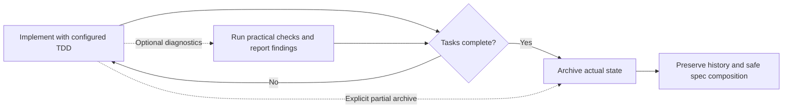

# Usage

← [Back to README](../README.md)

---

## Persona Modes

| Persona   | ID          | Description                                                                       |
| --------- | ----------- | --------------------------------------------------------------------------------- |
| Gentleman | `gentleman` | Teaching-oriented mentor persona — pushes back on bad practices, explains the why |
| Neutral   | `neutral`   | Same teacher, same philosophy, no regional language — warm and professional       |
| Custom    | `custom`    | Mantiene la persona/configuración existente fuera de la gestión de Axiom |

`custom` es una opción de compatibilidad y propiedad, no un editor de personas. Úsala si ya tienes instrucciones propias y quieres que Axiom las deje intactas.

---

## Interactive TUI

Just run it — the Bubbletea TUI guides you through agent selection, components, skills, presets, and managed uninstall flows:

```bash
axiom
```

The uninstall flow is also available from the TUI menu. It lets you:

- select one or more configured agents
- select which managed components to remove (for example `sdd`, `persona`, or `context7`)
- confirm the exact uninstall scope before applying changes

Antes de modificar cualquier fichero gestionado, Axiom crea una copia de seguridad que permite restaurar la configuración si es necesario.

### Receipt-Driven Development during installation

Before the final installation confirmation, the customizable installer explains Receipt-Driven Development (RDD) and asks you to choose **RDD ON** or **RDD OFF**. RDD records bounded, independent review evidence for a frozen change candidate and supports a bounded correction process. It can add review time and model cost.

La elección es opcional y, si no existe una preferencia global, el valor predeterminado es OFF. Puedes volver desde la pantalla de confirmación para cambiarla. Axiom guarda la preferencia global seleccionada solo cuando la instalación termina correctamente; una instalación interrumpida o fallida no la modifica. Los ajustes locales existentes de cada clon se conservan, por lo que el modo efectivo de un clon puede diferir del global. La evidencia de RDD no autoriza commits, pushes, pull requests ni releases: la entrega sigue sujeta a las normas habituales del repositorio.

### RDD por usuario y proyecto

Además del interruptor global y del «apagar» de cada clon, puedes fijar tu propia preferencia de RDD para un proyecto registrado en tu hub:

```bash
# Encendido para ti en este proyecto
axiom review mode enable --scope project

# Apagado para ti en este proyecto
axiom review mode disable --scope project

# Retira la preferencia: vuelve a mandar el global
axiom review mode inherit --scope project

# Muestra cada fuente y cuál decide
axiom review mode status
```

La preferencia es tuya y de esta máquina: se guarda en el registro del hub (`~/.axiom/workspaces.json`, junto a las preferencias de worktree), nunca en `axiom.yaml` ni en `.axiom/state.json`, así que no se versiona y ningún repositorio puede imponerla. El proyecto es el registrado que contiene el repositorio; en multirepo, los repositorios de los roles y el de especificaciones pertenecen al proyecto de la carpeta maestra. Fuera de un proyecto registrado, `--scope project` falla con un mensaje que lo dice.

Precedencia, de mayor a menor:

1. El «apagar» del clon (`--scope clone`) gana siempre.
2. Tu preferencia de proyecto, en ambos sentidos: puede encender un proyecto aunque el global esté apagado, o apagarlo aunque esté encendido.
3. El interruptor global.
4. Si nadie ha expresado una opinión, apagado.

`axiom review mode status` informa del modo efectivo y de la fuente que decide (`clone_local`, `project`, `global` o `default`), además del valor de cada fuente. Quitar el «apagar» del clon mientras tu preferencia de proyecto esté en `off` se rechaza, porque no encendería nada; el mensaje nombra el comando del origen que decide.

El dashboard muestra lo mismo en la tarjeta **Revisión (RDD) de este proyecto** de la pantalla Ecosistema: el modo efectivo, la fuente que decide y un selector para heredar, encender o apagar el proyecto abierto. El mismo selector está en el alta de proyecto.

### Disable TUI spinner animation

Define `AXIOM_NO_ANIMATION=1` para detener la animación del indicador de la TUI. El nombre anterior `GENTLE_AI_NO_ANIMATION` se mantiene como alternativa de compatibilidad:

```bash
AXIOM_NO_ANIMATION=1 axiom
```

Esto solo detiene la animación del indicador; las operaciones de instalación, actualización, sincronización y desinstalación siguen funcionando con normalidad. Elimina la variable o asígnale un valor distinto de `1` para conservar la animación predeterminada. `AXIOM_NO_ANIMATION` tiene prioridad sobre la variable heredada.

---

## CLI Commands

### install

Configuración inicial: detecta tus herramientas y configura los agentes y componentes seleccionados. Al instalar un único agente con `--agent X`, Axiom **añade** el nuevo agente a la lista `installed_agents` existente en el estado del ámbito (`~/.axiom/state.json` en global; `.axiom/state.json` en la raíz del proyecto en workspace; si el proyecto aún no tiene el suyo, las preferencias parten del estado global como semilla de solo lectura, sin los agentes, véase [Estado de instalación por proyecto](#cli-flags-install)) y **conserva** los valores de `model_assignments`; no sobrescribe todo el estado. Si solo existe el estado heredado en `~/.gentle-ai/state.json`, Axiom puede migrarlo al directorio actual.

**Ámbito predeterminado: el proyecto.** `install`, `setup`, `sync` y `uninstall`, y también la TUI, trabajan por defecto con `--scope workspace`: escriben en la raíz del proyecto y no en tu carpeta de usuario. El ámbito global sigue disponible, pero hay que pedirlo (`--scope global` o `AXIOM_INSTALL_SCOPE=global`) y `install` lo avisa antes de escribir. Con el ámbito workspace:

- Axiom no escribe en tu HOME salvo lo declarado: el binario `axiom`, el binario de Engram y el registro del hub (`~/.axiom/workspaces.json`). `~/.axiom` (o `AXIOM_STATE_DIR`) solo guarda el hub, las copias de seguridad, `bin` y la caché; el estado de cada proyecto vive en `<raíz>/.axiom/state.json`, sin versionar.
- Lo opcional es opt-in. GGA y CodeGraph no entran en ningún preset y hay que pedirlos expresamente; si los eliges, conservan su huella en HOME y Axiom la avisa.
- El componente de permisos solo añade reglas de denegación (`deny`) y nunca fija modos de autoaprobación. Detalle en [Componentes](components.md).
- Un directorio cuenta como proyecto de Axiom solo si tiene un `axiom.yaml` propio, o el que se alcanza mediante el puntero `.axiom-workspace` de un multirepo, en él o en un ancestro. Un `openspec/` suelto no basta. Los hooks que Axiom instala (registro de skills, guarda de rama, preflight SDD y stop-hook de revisión) no hacen nada fuera de un proyecto así.
- Cada agente recibe su configuración en las rutas de proyecto que lee (véase [Agentes](agents.md#modo-workspace-por-agente)). Windsurf, Trae, Antigravity, Pi y OpenClaw no tienen modo workspace y se omiten con un aviso; Kimi Code, Qwen Code y Hermes ya no se pueden elegir ([agentes no disponibles](agents.md#agentes-no-disponibles-de-momento)).

```bash
# Ecosistema completo para varios agentes
axiom install \
  --agent claude-code,opencode,gemini-cli \
  --preset full-gentleman

# Configuración mínima para Cursor
axiom install \
  --agent cursor \
  --preset minimal

# Configuración de OpenClaw después de instalarlo manualmente
axiom install \
  --agent openclaw \
  --preset full-gentleman

# Selección de componentes y skills concretos
axiom install \
  --agent claude-code \
  --component engram,sdd,skills,context7,persona,permissions \
  --skill go-testing,skill-creator,work-unit-commits,issue-creation \
  --persona gentleman

# Previsualiza primero el plan sin aplicar cambios
axiom install --dry-run \
  --agent claude-code,opencode \
  --preset full-gentleman
```

### skill-registry refresh

Refresh the project-local skill registry used by orchestrators before they delegate work:

```bash
axiom skill-registry refresh
axiom skill-registry refresh --force
axiom skill-registry refresh --cwd /path/to/project --quiet
```

The command scans project skills first (`skills/`, `.opencode/skills/`, `.claude/skills/`, `.github/skills/`, and other supported workspace skill roots), then global agent skill directories. Project-local skills win over same-name global skills.

The command writes `.atl/skill-registry.md` and `.atl/.skill-registry.cache.json`. The cache fingerprint includes schema version plus each discovered `SKILL.md` file path, mtime, and size, so normal startup is a cheap cache-hit when skills have not changed.

Codex, Claude Code, and OpenCode installs wire this command into startup/plugin hooks. Pi gets the equivalent behavior from `gentle-pi`; keep those hook/plugin scan roots in sync when changing these discovery rules.

El registro es inerte fuera de los proyectos de Axiom, es decir, donde ni el directorio ni ninguno de sus ancestros tiene un `axiom.yaml` (propio o alcanzado por un puntero `.axiom-workspace`). Allí el comando, tanto lanzado a mano como por un hook, termina con código 0 sin crear `.atl/`, sin tocar el `AGENTS.md` del repositorio y sin guardar nada en Engram; con `--quiet` no imprime nada. Así los hooks instalados en tu equipo no ensucian repositorios ajenos. Dentro de un proyecto, la sección `## Skills` de `AGENTS.md` apunta cada skill a una sola carpeta: si una skill existe en `.agents/skills` y en la carpeta propia de un agente, el índice usa la compartida `.agents/skills`; una copia en `skills/` o en una raíz declarada en `axiom.yaml` sigue ganando a ambas.

See [Skill Registry](skill-registry.md) for the full index-first flow and diagrams.

### sync

Actualiza los recursos gestionados a la versión vigente. Ejecútalo después de sustituir o actualizar el binario `axiom`, por ejemplo con `axiom upgrade` o `go install`. No reinstala otros binarios (Engram, GGA); solo actualiza el contenido de prompts, las skills, las configuraciones MCP y los orquestadores SDD.

Managed reviewer and runtime assets are version-bound to the binary. Until sync succeeds, review lifecycle operations fail closed when managed writer provenance is missing or mismatched.

> **Importante:** `axiom sync` actualiza los agentes registrados como instalados por Axiom, no todos los directorios de configuración de agentes de tu equipo.
>
> Axiom guarda los destinos seleccionados en `~/.axiom/state.json` con `--scope global` y en `<raíz del workspace>/.axiom/state.json` con `--scope workspace` (el ámbito predeterminado de la TUI y de `setup`). Las siguientes ejecuciones de `sync` utilizan esa selección para no escribir accidentalmente en herramientas que no hayas elegido gestionar. El estado existente en `~/.gentle-ai/state.json` es una fuente de migración heredada, no la ruta actual. Si repites la instalación y seleccionas un único agente, esa selección pasa a ser el ámbito predeterminado de sincronización.
>
> Antes de sincronizar, puedes previsualizar el ámbito activo con `axiom sync --dry-run`. Para sincronizar agentes que no figuran en la selección guardada, indícalos explícitamente con `--agent`.

```bash
# Previsualiza qué agentes actualizará la sincronización
axiom sync --dry-run

# Sincroniza los agentes registrados en el estado del ámbito (~/.axiom/state.json en global, .axiom/state.json del proyecto en workspace)
axiom sync

# Sincroniza solo agentes concretos
axiom sync --agent claude-code --agent opencode

# Actualiza las instrucciones del workspace y la configuración MCP de OpenClaw
axiom sync --agent openclaw
```

Sync is safe and idempotent — running it twice produces no changes the second time. When files change, the summary reports the changed file count and lists the changed file paths. Every report (changes, no-op and `--dry-run`) also names the effective scope and its root right after the header, for example `Scope: workspace (C:\repos\axiom)` or `Scope: global (C:\Users\me)`. The default scope is `workspace`, so use `axiom sync --scope global` to refresh the user-wide installation.

`sync` actualiza el conjunto de componentes gestionados para los agentes seleccionados. No admite `--component`; usa `--include-permissions` para incluir voluntariamente el componente de permisos (solo añade reglas de denegación y sigue el ámbito). La TUI, y el `axiom sync` diferido que Axiom lanza tras una autoactualización, añaden `--include-permissions` por su cuenta cuando descubren Codex; es inocuo, porque Codex no tiene overlay de permisos en ningún ámbito y no se escribe nada para él. La opción heredada `--include-theme` aún se interpreta por compatibilidad, pero no instala ni sincroniza temas.

GGA y CodeGraph son opcionales: ningún preset los instala y `sync` no los añade por su cuenta. Si ya los tenías, `sync` los mantiene: GGA, por la selección guardada o por el aprovisionamiento previo de Axiom en el HOME; CodeGraph, por la selección guardada o por la guía gestionada que Axiom ya escribió.

Tras actualizar el binario, `axiom sync --dry-run` previsualiza los destinos seleccionados y `axiom sync` actualiza sus instrucciones principales de autorización remota. Para elegir un cliente gestionado concreto, por ejemplo, usa `axiom sync --agent opencode`. Estas instrucciones de comportamiento se incorporan siempre, sin necesidad de seleccionar persona, SDD o `--include-permissions`. Exigen autorización explícita del destino, la operación y las credenciales o sesión antes de realizar trabajo remoto o descubrir y reutilizar accesos existentes.

This update covers the 15 non-Pi primary instruction carriers only. Executor roles, named profiles, and Pi's package-owned instructions require separate behavioral coverage. Existing automation modes and remembered approvals may suppress runtime prompts. The guidance is not a sandbox or a fresh-human-per-execution guarantee. Shared settings merging and profile cleanup preserve existing permission-rule order.

Para activar por separado las solicitudes nativas de autorización de comandos remotos en OpenCode, usa `axiom sync --agent opencode --include-permissions` (o `--agent kilocode` para la configuración generada compartida). De forma predeterminada se solicita autorización para `ssh`, `scp`, `sftp` y `rsync` directos, con o sin argumentos; también se solicita de forma conservadora para `rsync` local. Las restricciones existentes y las autorizaciones personalizadas explícitas siguen teniendo prioridad, por lo que una configuración propia puede permitir comandos remotos. Los valores predeterminados no reescriben esas autorizaciones. Las excepciones por agente y las autorizaciones recordadas también pueden omitir la solicitud.

Matcher fixtures follow OpenCode [v1.2.27 wildcard matching](https://github.com/anomalyco/opencode/blob/v1.2.27/packages/opencode/src/util/wildcard.ts) and its last-matching permission evaluation. They do not prove interception of absolute executable paths, env wrappers, interpreters, or arbitrary compound shell syntax; the runtime extracts command nodes separately. Kilocode runtime equivalence is not verified. Issue #4324 remains open for all-client/all-role completion.

For OpenClaw, sync reads the active workspace from `~/.openclaw/openclaw.json` (`agents.defaults.workspace`). It writes `AGENTS.md` / `SOUL.md` into that workspace, while MCP servers stay in the global OpenClaw config under `mcp.servers`.

Hermes no está disponible de momento: no se puede elegir al instalar y `axiom install --agent hermes` falla (véase [agentes no disponibles](agents.md#agentes-no-disponibles-de-momento)). Lo que sigue describe el adaptador conservado. Para Hermes, Axiom solo detecta la instalación: no instala Hermes. Instálalo manualmente primero. La detección se basa en el directorio de configuración `~/.hermes` (la presencia del binario en `PATH` se informa por separado). Una vez detectado Hermes, `axiom install --agent hermes` añade bloques MCP de Context7 y Engram a `~/.hermes/config.yaml`, escribe el orquestador SDD y la persona en `~/.hermes/SOUL.md` y copia las skills a `~/.hermes/skills/`. Usa `axiom sync --agent hermes` para actualizar la configuración gestionada tras una actualización.

### uninstall

Elimina únicamente la configuración de Axiom de uno o más agentes. No desinstala paquetes ni binarios externos: retira secciones gestionadas de prompts, entradas MCP, skills, fragmentos de configuración y otros ficheros gestionados; después actualiza el estado de instalación del ámbito.

Antes de aplicar cualquier cambio, Axiom crea una copia de seguridad de los ficheros afectados.

`uninstall` tiene el mismo ámbito que `install` y `sync`: `--scope workspace` (el valor por defecto) o `--scope global`, o la variable `AXIOM_INSTALL_SCOPE`. Cada ámbito revierte lo suyo y no toca el otro.

```bash
# Desinstalación parcial para agentes concretos (ámbito workspace, el predeterminado)
axiom uninstall \
  --agent claude-code \
  --agent opencode

# Desinstalación parcial solo de componentes concretos
axiom uninstall \
  --agent claude-code \
  --component sdd,persona,context7

# Desinstalación completa del proyecto: todo lo que Axiom gestiona en este workspace
axiom uninstall --all

# Desinstalación completa de lo que Axiom tiene en tu carpeta de usuario
axiom uninstall --all --scope global

# Además, borra la raíz de estado de Axiom (~/.axiom o AXIOM_STATE_DIR)
axiom uninstall --all --scope global --purge-state

# Omite la solicitud de confirmación
axiom uninstall --agent cursor --component skills --yes
```

En una desinstalación parcial sin `--component`, Axiom retira todos los componentes desinstalables que gestiona para los agentes seleccionados.

#### Ámbito workspace

La raíz del proyecto es la misma que usa `install` (el `axiom.yaml` más cercano o, si no hay, la raíz git), así que lanzar el comando desde una subcarpeta revierte el proyecto entero y avisa de ello. `HOME` no se toca. Por agente, `uninstall` retira lo que `install` y `sync` escriben en el proyecto:

| Agente | Se retira del proyecto | Se conserva |
| --- | --- | --- |
| Claude Code | `.claude/` gestionado (agentes, comandos, skills, `output-styles/axiom.md`), las secciones de `.claude/CLAUDE.md`, los hooks de Axiom y las reglas `permissions.deny` de Axiom en `.claude/settings.json`, y las entradas `engram` y `context7` de `.mcp.json` | Tu `deny`, tu `defaultMode`, tus servidores MCP y tus agentes y skills propios |
| OpenCode | Las claves gestionadas de `opencode.json(c)` (agentes con la marca de Axiom, `mcp.engram`, `mcp.context7`, reglas `permission` de Axiom, `default_agent` solo si lo puso Axiom), la entrada de `instructions` que apunta a `.opencode/axiom.md`, ese fichero y `.opencode/{commands,plugins,prompts/sdd}` | El resto de `opencode.json`, tus `instructions` y tus servidores MCP |
| Kilo | Lo mismo en `kilo.json(c)` y `.kilo/` (incluida `.kilo/rules/axiom.md` y su entrada de `instructions`) | Lo del equipo |
| Gemini CLI | `.gemini/AXIOM.md`, su nombre en `context.fileName` (la clave entera si solo quedan los nombres por defecto) y `mcpServers.engram` y `mcpServers.context7` de `.gemini/settings.json` | Los demás nombres de `context.fileName`, `GEMINI.md` y tu configuración |
| Codex | El bloque `<!-- axiom:workspace-instructions -->` de `developer_instructions` en `.codex/config.toml`, `.codex/axiom-instructions.md`, `.codex/engram-compact-prompt.md`, `.codex/hooks.json` (solo los hooks de Axiom), `[mcp_servers.engram]`, `[mcp_servers.context7]` y las claves que Axiom escribe con su valor (`experimental_compact_prompt_file`, `features.multi_agent = true`, `agents.max_threads = 4`, `agents.max_depth = 2`) | El texto tuyo de `developer_instructions`, tus servidores y cualquier otra clave o valor |
| VS Code Copilot | `.github/instructions/axiom.instructions.md` y los servidores `engram` y `context7` de `.vscode/mcp.json` | `.github/copilot-instructions.md`, tus servidores y tus `inputs` |
| Cursor, Kiro | Sus carpetas de proyecto gestionadas (`.cursor/`, `.kiro/`) con el mismo criterio | Lo del equipo |
| Skills compartidas | Las skills de Axiom de `.agents/skills` y `.claude/skills` (solo mientras ningún otro agente instalado en el proyecto use esa carpeta) | Tus skills |
| Estado del proyecto | `.axiom/state.json` y su cerrojo cuando ya no queda ningún agente instalado, y las líneas que Axiom añadió a `.git/info/exclude` | El resto de `.axiom/` |

Reglas generales:

- Solo se retira lo que Axiom escribió. Una entrada MCP con el nombre `engram` o `context7` pero otra definición, una clave con otro valor o un fichero de instrucciones que editaste se conservan y se avisa.
- Los ficheros que Axiom escribe enteros (`axiom.md`, `AXIOM.md`, `axiom-instructions.md`, `axiom.instructions.md`) se borran solo si, tras quitar las secciones de Axiom, no queda nada tuyo. Si lo editaste, se conserva sin las secciones de Axiom y con un aviso.
- Las carpetas que quedan vacías se quitan; las que tienen contenido del equipo, nunca.
- Los JSON que se reescriben pierden los comentarios y se reindentan, igual que cuando `install` los fusiona.
- El `AGENTS.md` del equipo no se toca, salvo el bloque `axiom:skills-index` que mantiene el registro de skills. De `.atl/` solo salen los ficheros que genera ese registro (`skill-registry.md` y su caché); `.atl/skills` es tuyo.
- Repetir la desinstalación no falla ni cambia nada más.

#### Ámbito global

Revierte lo que Axiom escribió en tu carpeta de usuario con la misma regla de «solo lo de Axiom» (por ejemplo, de `~/.claude/settings.json` solo salen las reglas `deny` de Axiom: tu `deny` y tu `defaultMode` se quedan). Con `--all` retira además:

- **Entradas de PATH gestionadas**, con las funciones que ya usa `install`: el directorio del binario de Engram (solo donde Axiom lo registra en el PATH, es decir, `%LOCALAPPDATA%\engram\bin` en Windows; en Linux y macOS el binario está en carpetas compartidas como `/usr/local/bin` y no se toca), `~/bin` solo si la configuración de GGA es de Axiom, y la carpeta de lanzadores `<estado>/bin`. Las demás entradas del PATH se quedan como estaban y en su orden.
- **La copia de skills de compatibilidad** de `~/.agents/skills` (solo las skills de Axiom) y los shims y el script del modo PR que Axiom escribe para GGA. El binario y el runtime de GGA no son de Axiom y se quedan.
- Con **`--purge-state`**, la raíz de estado de Axiom (`~/.axiom` o `AXIOM_STATE_DIR`): estado, caché, lanzadores y copias de seguridad, incluida la de esta desinstalación. Nunca se purga por defecto y solo se admite con `--all` y el ámbito global. Si el registro del hub (`workspaces.json`) lista proyectos, el hub se conserva y se borra todo lo demás; para borrarlo también hay que añadir **`--purge-hub`**. Una raíz de estado que contiene `HOME` o el proyecto, o la raíz del disco, no se purga nunca.

`~/.gentle-ai`, el estado de versiones anteriores, no se borra aunque exista (comparte nombre con la herramienta original): el informe te avisa para que lo quites a mano.

#### Migrar de una instalación global a una por proyecto

Si tu equipo instaló Axiom en global y quiere pasar a instalar por proyecto:

1. `axiom doctor` lista en «Huella de máquina» lo que Axiom tiene a nivel de usuario y marca como `[resto global]` lo que sobra si solo vas a trabajar con workspaces.
2. `axiom uninstall --all --scope global` retira esa configuración global (también los restos de Kilo, Kiro y Codex que solo tienen la forma de Axiom: lo que hayas editado se conserva con aviso, y un `mcp.json` solo se borra si no tenía nada más que servidores de Axiom) y las entradas de PATH gestionadas (añade `--purge-state` si además quieres borrar `~/.axiom`).
3. En cada proyecto, `axiom setup` (o `axiom install`) con el ámbito workspace, que es el predeterminado.
4. Cuando quieras volver a dejar un proyecto como estaba, `axiom uninstall --all` desde él.

Una skill personal con el mismo nombre que una skill de proyecto prevalece sobre esta en Claude Code: si usabas una copia global de las skills de Axiom, retírala en el paso 2 antes de instalar en el proyecto.

### update / upgrade

Busca e instala nuevas versiones de Axiom. La copia de seguridad previa a la actualización incluye únicamente los agentes registrados en `state.InstalledAgents` (`~/.axiom/state.json`), no todos los directorios de configuración de agentes que existan en el equipo. Los ficheros `~/.gentle-ai/state.json` que ya existan son fuentes de migración heredadas.

```bash
# Comprueba si hay una versión nueva
axiom update

# Actualiza a la última versión publicada y sustituye el binario actual
axiom upgrade
```

Después de una actualización o de sustituir manualmente el binario, ejecuta `axiom sync` para actualizar todos los recursos gestionados al contenido de la nueva versión.

Si GitHub limita las comprobaciones de actualización, define `GITHUB_TOKEN` o `GH_TOKEN` antes de ejecutar `axiom update` o `axiom upgrade`.

#### Actualizar desde el dashboard

Al abrirse, `axiom ui` comprueba si hay una versión publicada más nueva. Guarda el resultado unas 6 horas y ofrece un botón para volver a comprobar. Si la hay, muestra un aviso con la versión actual, la nueva y el botón **Actualizar**, que hace lo siguiente:

1. Actualiza Axiom. Muestra en el aviso cada fase (comprobación, actualización, reinicio, sincronización).
2. Relanza el dashboard con el binario nuevo, sin consola y en el mismo puerto (el fijo `47700`, o el que hayas pasado con `--port`), de modo que la URL y la aplicación instalada (PWA) siguen siendo las mismas. La página se recarga sola cuando responde la versión nueva. Lo que escriba el proceso relanzado queda en `ui.log` (`%LOCALAPPDATA%\axiom\ui.log` en Windows; el directorio de caché del usuario en otros sistemas).
3. El binario nuevo sincroniza el workspace abierto (`axiom sync --scope workspace`). El proceso viejo nunca sincroniza, porque lo haría con los recursos de la versión anterior. Si la carpeta abierta no tiene `axiom.yaml`, no se sincroniza.

Si falla alguna fase, o si el proceso nuevo muere nada más arrancar, el dashboard viejo sigue funcionando y el aviso muestra el comando para hacerlo a mano (`axiom ui --path "<carpeta>"`) y, en el segundo caso, la ruta de `ui.log`. En Windows la actualización usa `go install`. Para que funcione, Go tiene que estar instalado y el `axiom` del `PATH` tiene que ser el de `GOBIN`. Si no es así, el aviso muestra el comando manual.

El acceso directo del menú Inicio y la tarea programada `Axiom` (`axiom ui --detach`) apuntan al ejecutable que instaló `install.ps1`. La actualización en Windows exige que ese sea el `axiom` del `PATH` donde se escribe la versión nueva, así que siguen funcionando tras actualizar.

La acción solo se acepta desde el propio dashboard (`127.0.0.1` o `localhost` en su puerto); una página web externa no puede lanzarla.

Para instalar o actualizar Axiom, sigue el [Inicio rápido](quickstart.md), que documenta la instalación. El método habitual son los dos comandos de una línea (`install.sh` en Linux/macOS, `install.ps1` en Windows); Axiom no se distribuye por Homebrew.

**Self-update prompt behavior** (changed in v1.x slice 5 — `GENTLE_AI_CONFIRM_UPDATE` removed):

| Situation | Behavior |
|-----------|----------|
| Interactive terminal (TTY) | Always prompts `Apply now? [Y/n]`. Empty Enter accepts. |
| Non-TTY (CI, pipe, script) | Auto-declines — never hangs. |
| `GENTLE_AI_YES=1` | Variable heredada que acepta sin preguntar (para actualizaciones mediante scripts). Se hereda en los subprocesos; si es necesario, limítala a una invocación (por ejemplo, `GENTLE_AI_YES=1 axiom upgrade …`). |
| `GENTLE_AI_NO_SELF_UPDATE=1` | Variable heredada que omite por completo la comprobación de actualización automática. |

`GENTLE_AI_CONFIRM_UPDATE` was removed in slice 5. It is now ignored if set.

`GENTLE_AI_SELF_UPDATE_DONE` es un control interno del bucle de actualización y no debe definirse manualmente.

### model assignment

The TUI **Configure Models** screen can assign different models to SDD phases, `sdd-onboard`, and Judgment Day agents (`jd-judge-a`, `jd-judge-b`, `jd-fix-agent`) when the selected agent supports those slots. This lets you keep review or apply phases on stronger models while routing cheaper phases to faster models.

For Claude Code, the Custom picker offers `default`, `low`, `medium`, `high`, `xhigh`, and `max` for Sonnet, Opus, and Fable. An explicit effort is passed to the in-process reviewer with `--effort` and written to generated agent frontmatter; `default` inherits the runtime default. Haiku offers only `default`.

### doctor

Diagnóstico de solo lectura del estado del ecosistema; no modifica la configuración:

```bash
axiom doctor
```

Checks performed:

| Check | What it verifies |
|-------|-----------------|
| Tool binaries | Required tools (`axiom` and Engram, plus the binaries of the selected agents) present on `PATH`; shadow detection (wrong binary resolves first). GGA is only required when you selected it explicitly |
| Validez de `state.json` | Analiza el estado del proyecto actual (`.axiom/state.json`) si existe y, si no, `~/.axiom/state.json`, e informa de errores de esquema o corrupción; puede migrar `~/.gentle-ai/state.json` si todavía no existe estado de Axiom |
| Engram MCP reachability | Confirms the Engram MCP server responds |
| Huella de máquina | Apartado informativo que lista lo que Axiom tiene a nivel de usuario: los binarios de `axiom` y Engram y el registro del hub (declarados) y, si existen, GGA, `~/.agents/skills`, los plugins de OpenCode en HOME, los restos de Kilo (`opencode.json` y plugins), de Kiro (steering `axiom.md`) y de Codex (`context7`, `features.multi_agent` y `agents.max_*` de `config.toml`), cada uno con su agente, CodeGraph global, las entradas de PATH gestionadas y `~/.gentle-ai`. Marca como `resto global` lo que solo deja una instalación global. No cuenta como aviso ni como fallo |
| Disk space | Warns when available space is critically low |
| Assets del proyecto (`project:assets`) | Solo si existe `.axiom/state.json` en el proyecto. Compara el digest de los assets gestionados del binario con el que registró la última instalación o sincronización del proyecto. Si difieren, avisa y propone `axiom sync --scope workspace` |
| Adaptadores del proyecto (`project:adapters`) | Solo si existe `.axiom/state.json`. Comprueba que los agentes registrados en el proyecto siguen presentes en el workspace |
| Workspace y topología (`project:workspace`, `project:topology`) | Solo si existe `axiom.yaml`. Valida la configuración e informa de la topología (`monorepo-embedded` o `multirepo`, con su ruta global) |
| Repos de rol (`project:role_repos`) | Cada repositorio de rol declarado existe (si falta, es un fallo) y es un repositorio git (si no lo es, es un aviso). No se comprueba la rama |
| Repo de specs (`project:specs_repo`) | El repositorio de specs declarado existe y es un repositorio git |

Each check reports **pass**, **warn**, or **fail** with an optional remedy hint. Run `doctor` first when troubleshooting an unexpected install or sync result.

Las comprobaciones de proyecto se hacen sobre la raíz del proyecto: en la CLI, la que contiene la carpeta actual; en el dashboard, el proyecto abierto. Ninguna usa la red.

En el dashboard (`axiom ui`), el doctor se ejecuta al abrirlo y cada vez que cambias de proyecto. El informe del proyecto anterior desaparece en cuanto cambias. La pantalla Ecosistema muestra dos secciones, **Global** y **Proyecto**, y el estado general es correcto solo si ninguna comprobación falla.

### init

Crea el `axiom.yaml` de un proyecto, sus carpetas canónicas (`openspec/` y `.axiom/inbox/skills/`) y lo registra en el hub:

```bash
# El directorio actual, monorepo-embedded
axiom init

# Otra carpeta, con nombre
axiom init --path ../mi-proyecto --name "Mi proyecto"

# Multirepo, con la carpeta maestra indicada
axiom init --topology multirepo --path ../maestra
```

Antes de escribir nada, `axiom init` valida la configuración que va a generar con las mismas reglas que `axiom workspace validate` y rechaza, con la lista completa de errores y sin tocar el disco, estos casos:

- claves de rol repetidas (también si solo se distinguen por las mayúsculas) o roles sin clave ni nombre;
- repositorios de rol con ruta absoluta o que salen de la carpeta del proyecto (`..`); los repositorios de rol deben ser relativos, pero no tienen que existir todavía;
- un `gate_policy` fuera de `blocking`, `deferred` y `optional`.

Las claves de rol se escriben entre comillas cuando hace falta (con `:`, espacios o palabras como `yes`). Un rol no bloqueante se escribe con `gate_policy: "deferred"` (antes se escribía `advisory`, que el detector de roles no admite; los `axiom.yaml` que ya lo tengan no se migran solos). El dashboard muestra el `gate_policy` real de cada rol.

Si ya existe un `axiom.yaml` y no se pasa `--force`, se conserva y no se valida nada generado.

### version

```bash
axiom version
axiom --version
axiom -v
```

### ui

Inicia el panel web local en `http://127.0.0.1:47700` (puerto fijo). Si el directorio actual no tiene `axiom.yaml`, usa el workspace activo del hub.

```bash
axiom ui                 # abre el panel en el navegador por defecto
axiom ui --detach        # servidor en segundo plano, sin consola, y abre el navegador
axiom ui --port 47800    # otro puerto (la PWA instalada queda ligada al puerto original)
axiom ui --no-browser    # solo el servidor, sin abrir ventana
```

Es idempotente: si ya hay un Axiom escuchando en el puerto, solo abre la ventana. Si lo ocupa otra aplicación, falla con un error que sugiere `--port`.

#### Alta de proyecto desde el dashboard

El botón de añadir proyecto abre un modal que da de alta un proyecto con su configuración completa. Pide:

- **Ruta y nombre** del proyecto.
- **Topología**, `monorepo-embedded` o `multirepo`. Con multirepo aparece el **repositorio de especificaciones**, una ruta relativa a la carpeta del proyecto (obligatoria, distinta de la propia carpeta y dentro de ella). Si no existe, el alta lo crea (sin `git init`), escribe en él `axiom.yaml` y `openspec/` y deja en la carpeta del proyecto el puntero `.axiom-workspace` (`config: <repo>/axiom.yaml`). Después comprueba el resultado con el mismo localizador que usan los demás comandos.
- **Roles**, opcionales: identificador, nombre, repositorios (rutas relativas separadas por comas), tecnologías y si es no bloqueante, que se escribe como `deferred`. Sin roles se crea uno `fullstack`.
- **Adaptadores**, opcionales, que se instalan en el proyecto en modo workspace. Los que solo tienen configuración global (Pi, OpenClaw, Windsurf, Antigravity y Trae) aparecen deshabilitados con el motivo. No elegir ninguno es válido: el proyecto queda sin adaptadores y se pueden instalar después con `axiom install --scope workspace`.
- **Preferencias personales**: modo de trabajo y raíz de worktrees, y la preferencia de RDD del proyecto (heredar, encendida o apagada). Se guardan en tu hub, no en `axiom.yaml`.

Todo se valida antes de escribir nada. Los errores de formulario (ruta vacía, claves repetidas, repositorios absolutos o fuera del proyecto, repositorio de specs inválido) se avisan en el propio modal, y el servidor repite la validación y responde con `400` y la lista completa de violaciones, que el modal muestra una por línea; no se crea ni registra nada. Un adaptador que no existe o no admite workspace también se rechaza antes de escribir.

Los adaptadores se instalan después de escribir el proyecto, en su carpeta y con el mismo código que `axiom install --scope workspace`, sin depender del directorio desde el que se lanzó el dashboard. Si la instalación falla, el proyecto queda creado y registrado, y el modal se cierra con un aviso que explica el fallo; no se deshace nada. Lo mismo ocurre si no se puede guardar la preferencia de RDD.

`POST /api/projects/init` y `POST /api/project/review-mode` solo aceptan peticiones del propio dashboard (`127.0.0.1` o `localhost` en su puerto): con un `Origin` o `Host` ajenos responden `403` sin hacer nada.

#### Modelo por fase desde el dashboard

En **Ecosistema → Modelos** hay una tabla editable por cada adaptador instalado en el proyecto abierto, con una fila por fase SDD (y por agente de Judgment Day) y dos columnas: modelo y esfuerzo. Admiten asignación por fase:

- **OpenCode**: proveedor y modelo, elegidos del catálogo de OpenCode (texto libre si el catálogo no está disponible).
- **Claude Code**: alias de modelo y esfuerzo, restringido a los valores válidos de ese modelo.
- **Copilot** (VS Code Copilot y Copilot CLI): nombre del modelo en texto libre con el formato `<Nombre> (copilot)` y esfuerzo opcional. Véase [Agentes por fase de Copilot](agents.md#agentes-por-fase-de-copilot).

El botón **Guardar** de cada adaptador envía solo las fases cambiadas. Si hay violaciones, se listan en línea y no se guarda nada. Si todo es válido, Axiom guarda las asignaciones en el `.axiom/state.json` del proyecto abierto (`model_assignments` para OpenCode, `claude_phase_assignments` para Claude Code y `copilot_phase_assignments` para Copilot) y regenera los ficheros del adaptador sin cambiar de directorio. Si la regeneración falla, el estado vuelve a su valor anterior.

Para quitar una fase, vacía su modelo y guarda: la fase vuelve a heredar el modelo de la conversación (Claude Code y Copilot) o al valor por defecto.

Salvedades:

- **OpenCode**: el modelo por fase solo tiene efecto en el modo SDD multi. Quitar una fase solo la olvida en el estado: el modelo ya escrito en `opencode.json` se conserva, porque la sincronización respeta lo que existe. La pantalla avisa de ambas cosas.
- **Copilot** (VS Code Copilot y Copilot CLI): los agentes por fase viven solo en `.github/agents` del proyecto, que leen los dos. El guardado persiste la asignación en el estado del proyecto y regenera esa carpeta tanto si el proyecto tiene VS Code Copilot como si solo tiene Copilot CLI. No se escribe nada en `~/.copilot/agents`: Copilot CLI da prioridad al agente personal frente al del proyecto cuando coinciden los identificadores, y taparía el modelo elegido. Si una versión anterior dejó agentes de Axiom ahí, un `axiom sync`, `axiom install` o `axiom upgrade` global los retira y conserva los tuyos.
- El adaptador debe estar instalado en el proyecto; si no, el guardado se rechaza con `400`.

`GET /api/ecosystem/models` devuelve las asignaciones y las opciones de cada adaptador instalado, y `POST /api/ecosystem/models` guarda un parche por adaptador. Solo el `POST` modifica algo, y, como los demás de este panel, solo acepta peticiones locales (`127.0.0.1` o `localhost` en su puerto): con un `Origin` o `Host` ajenos responde `403` sin hacer nada. Sin proyecto abierto responde `409`.

#### Usar `axiom ui` como aplicación de escritorio

El flujo recomendado es instalar el panel como aplicación (PWA) desde el navegador y anclar ese icono; el servidor arranca solo con Windows.

1. **Abre el panel.** El instalador (`scripts/install.ps1`) crea el acceso directo `Axiom` en el menú Inicio (`axiom ui --detach`, minimizado). Con `-NoShortcut` no se crea. También puedes entrar en `http://127.0.0.1:47700`.
2. **Instálalo como aplicación.** En Chrome o Edge, usa el icono de instalar de la barra de direcciones o el botón **Instalar aplicación** del panel.
3. **Ancla el icono.** Ancla a la barra de tareas el icono de la aplicación instalada (no el del navegador).
4. **Servidor con Windows.** El instalador registra la tarea programada de usuario `Axiom` (al iniciar sesión, con 30 s de retraso, sin elevación) que ejecuta `axiom ui --detach --no-browser`, y la arranca una vez al instalar. Con `-NoAutostart` no se registra; entonces, arranca el servidor con `axiom ui --detach` o con el acceso directo. Para quitarla: `Unregister-ScheduledTask -TaskName Axiom -Confirm:$false`. No hay desinstalador del acceso directo: bórralo a mano del menú Inicio.
5. **Origen exacto.** La instalación queda ligada a `http://127.0.0.1:47700`: `localhost` u otro puerto serían otra aplicación distinta, con su propia instalación.
6. **Registro y parada.** `--detach` escribe el registro en `%LOCALAPPDATA%\axiom\ui.log`. No hay comando de apagado, por seguridad: el servidor vive hasta cerrar sesión; para pararlo antes, termina el proceso `axiom.exe` desde el Administrador de tareas (la tarea `Axiom` no lo relanza hasta el próximo inicio de sesión, salvo que falle).

---

## CLI Flags (install)

| Flag                          | Description                                                                                                       |
| ----------------------------- | ----------------------------------------------------------------------------------------------------------------- |
| `--agent`, `--agents`         | Agents to configure (comma-separated)                                                                             |
| `--component`, `--components` | Components to install (comma-separated); `gga` is optional and only installed when listed here                    |
| `--skill`, `--skills`         | Skills to install (comma-separated)                                                                               |
| `--persona`                   | Persona mode: `gentleman`, `neutral`, `custom` (`custom` keeps your existing persona unmanaged)                   |
| `--preset`                    | Preset: `full-gentleman`, `ecosystem-only`, `minimal`, `custom` (`custom` means manual component/skill selection) |
| `--sdd-mode`                  | SDD orchestrator mode: `single` or `multi`                                                                        |
| `--scope`                     | Ámbito de instalación: `workspace` (predeterminado, escribe en la raíz del proyecto actual) o `global` (escribe en la configuración global de cada agente seleccionado y afecta a todos los proyectos de la máquina; hay que pedirlo y se avisa). También admite `AXIOM_INSTALL_SCOPE`; `GENTLE_AI_INSTALL_SCOPE` es la alternativa heredada para CI y usos no interactivos. |
| `--dry-run`                   | Preview the install plan without applying changes                                                                 |

**Raíz del workspace.** Con `--scope workspace` (y con `axiom setup` y `axiom sync` en ese ámbito), la raíz no es la carpeta desde la que lanzas el comando, sino la del proyecto: la carpeta del `axiom.yaml` (o del puntero `.axiom-workspace`) más cercano hacia arriba; si no hay ninguno, la raíz del repositorio git que contiene la carpeta actual, o la del worktree enlazado, nunca la del checkout principal; y si tampoco hay repositorio, la propia carpeta actual. La raíz de un repositorio git que sea tu directorio personal no cuenta. Cuando la raíz difiere de la carpeta actual, Axiom lo avisa por la salida de errores. Así, lanzar `axiom sync` desde `internal/pkg` no crea `internal/pkg/.claude` ni `internal/pkg/.mcp.json`.

**Huella de máquina.** Con `--scope workspace`, `install`, `setup` y `sync` no escriben en tu carpeta de usuario salvo lo declarado: el binario `axiom`, el binario de Engram y el registro del hub (`~/.axiom/workspaces.json`). Estos pasos, que en el ámbito global sí se ejecutan, se omiten en workspace:

| Paso | Ámbito global | Ámbito workspace |
| ---- | ------------- | ---------------- |
| `engram setup <agente>` | Se lanza | Se omite y se avisa con el comando manual; el MCP de Engram ya queda en el proyecto |
| Copia de skills de compatibilidad (`~/.agents/skills`) | Se refresca si ya existe | No se toca |
| Limpieza de skills retiradas | Proyecto y HOME | Solo el proyecto |
| Refresco de plugins de OpenCode en HOME | Se refresca | No se toca; SDD escribe los plugins en el proyecto |

Lo que eliges de forma explícita (GGA, CodeGraph, plugins comunitarios de OpenCode) conserva su huella en HOME, porque es consentimiento expreso, pero Axiom la declara con un aviso al terminar: lista las rutas de HOME y, en Windows, la modificación del PATH de usuario. CodeGraph no tiene ubicación de proyecto en Axiom, así que se declara igual que GGA.

**Raíz de estado de máquina.** Todo lo que Axiom guarda a nivel de máquina cuelga de una única raíz, `~/.axiom` por defecto, que `AXIOM_STATE_DIR` mueve entera:

| Qué | Dónde (`<raíz>` = `~/.axiom` o `AXIOM_STATE_DIR`) |
| --- | --- |
| Registro del hub y preferencias personales | `<raíz>/workspaces.json` |
| Estado de usuario (`--scope global`) | `<raíz>/state.json` |
| Copias de respaldo | `<raíz>/backups/` |
| Caché | `<raíz>/cache/` |
| Lanzadores gestionados de OpenCode | `<raíz>/bin/` |
| Estado de sesión del stop-hook de revisión | `<raíz>/review-stop-hook/v1/` |

Con la variable definida, `install`, `setup` y `sync` no crean nada bajo `~/.axiom` ni `~/.gentle-ai`. Sin ella las rutas son las de siempre, así que nada cambia en un equipo existente. Efectos a tener en cuenta al estrenar la variable en un equipo que ya instaló:

- **PATH.** El PATH de usuario ya registrado sigue apuntando a `~/.axiom/bin`; `<raíz>/bin` se añade al activar de nuevo OpenCode en segundo plano. Los lanzadores de `~/.axiom/bin` nunca se toman como el OpenCode real.
- **Respaldos.** Las copias hechas antes en `~/.axiom/backups/` dejan de listarse (siguen en disco).
- **Raíz heredada `~/.gentle-ai`.** Solo se lee (estado, respaldos y marcas de sesión de versiones anteriores); no se escribe nada nuevo en ella.
- **Fuera de alcance.** La caché que escribe el plugin de OpenCode `model-variants` la gestiona el propio plugin y sigue en `~/.axiom/cache` (v1) o `~/.gentle-ai/cache/opencode-v2` (v2).

**Estado de instalación por proyecto.** Lo que Axiom recuerda de una instalación (agentes instalados, selección de componentes y skills, persona, asignación de modelos de Claude, Kiro, Codex y OpenCode, herramientas de comunidad e intenciones de segundo plano) vive donde vive la instalación:

| Ámbito | Fichero de estado |
| ------ | ----------------- |
| `--scope workspace` (`install`, `setup`, `sync` y la TUI) | `<raíz del workspace>/.axiom/state.json`, sin versionar |
| `--scope global` | `~/.axiom/state.json` (o `<AXIOM_STATE_DIR>/state.json`) |

Así, instalar o sincronizar el proyecto A no pisa la selección ni los modelos del proyecto B. El estado global conserva lo que es de la máquina: la comprobación de actualizaciones (`last_update_check`), la sincronización pendiente tras una autoactualización (`pending_sync`) y el interruptor de revisión (`rdd_mode`); el estado del proyecto nunca los guarda.

- **Compatibilidad.** Mientras un proyecto no tiene `.axiom/state.json`, la primera lectura en workspace toma el estado global como semilla de solo lectura, sin los campos de máquina ni la lista de agentes instalados, y no lo modifica. La semilla aporta preferencias (persona, modelos, componentes, skills, preset, intenciones de segundo plano), pero no los agentes: el estado global es la unión de todos los proyectos y de las instalaciones globales, y heredarlo haría que un `sync` del proyecto escribiera en tu carpeta de usuario la configuración de agentes sin modo workspace. Un proyecto que no ha instalado nada propio descubre los agentes por ficheros, como un equipo sin estado, y su `install --agent X` registra solo `X`. La primera escritura en workspace crea el fichero del proyecto y desde entonces manda el del proyecto: un cambio posterior en el estado global ya no le afecta.
- **Sin versionar.** Al crear el estado del proyecto, Axiom añade `/.axiom/state.json` y su cerrojo `/.axiom/state.json.lock` a `.git/info/exclude` (en un worktree enlazado, al del repositorio común). Es una exclusión local: no toca tu `.gitignore` ni deja un cambio que commitear en proyectos ajenos. Solo se excluyen esos dos ficheros, porque el resto de `.axiom/` (`inbox/skills/`, la caché y el buzón de autoskills) tiene otros usos. Si el proyecto no es un repositorio git no hay nada que excluir.
- **Lectores sin ámbito.** `axiom doctor` y las comprobaciones de la revisión leen el estado del proyecto de la carpeta actual si ya existe y, si no, el global.

## CLI Flags (sync)

| Flag                     | Description                                                                                          |
| ------------------------ | ---------------------------------------------------------------------------------------------------- |
| `--agent`, `--agents`    | Agents to sync (defaults to all installed agents)                                                    |
| `--skill`, `--skills`    | Skills to sync (comma-separated; defaults to selected preset skills)                                  |
| `--sdd-mode`             | SDD orchestrator mode: `single` or `multi`                                                           |
| `--strict-tdd`           | Enable Strict TDD Mode for SDD agents                                                                |
| `--profile`              | Create or update an SDD profile: `name:provider/model` (sets the default model for all phases)       |
| `--profile-phase`        | Override a specific phase in a profile: `name:phase:provider/model`                                  |
| `--sdd-profile-strategy` | OpenCode profile sync strategy: `generated-multi` or `external-single-active`                        |
| `--include-permissions`  | Include permissions sync (opt-in)                                                                    |
| `--include-theme`        | Opción heredada de compatibilidad: se interpreta, pero no instala ni sincroniza temas                  |
| `--dry-run`              | Preview the sync plan without applying changes                                                       |

**Profile examples:**

```bash
# Crea un perfil «cheap» con un modelo gratuito para todas las fases
axiom sync --profile cheap:openrouter/qwen/qwen3-30b-a3b:free

# Asigna un modelo más potente a la fase de diseño
axiom sync --profile-phase cheap:sdd-design:anthropic/claude-sonnet-4-20250514

# Crea varios perfiles en un único comando
axiom sync \
  --profile cheap:openrouter/qwen/qwen3-30b-a3b:free \
  --profile premium:anthropic/claude-sonnet-4-20250514

# Usa el modo de compatibilidad con un gestor externo de perfiles de OpenCode
axiom sync --agent opencode --sdd-profile-strategy external-single-active
```

See [OpenCode SDD Profiles](opencode-profiles.md) for the full guide.

## CLI Flags (uninstall)

| Flag                          | Description                                                             |
| ----------------------------- | ----------------------------------------------------------------------- |
| `--agent`, `--agents`         | Agents to uninstall managed config from (required unless using `--all`) |
| `--component`, `--components` | Managed components to remove only from the selected agents              |
| `--all`                       | Remove managed configuration from all supported agents                  |
| `--scope`                     | `workspace` (default, reverts the project) or `global` (reverts the user configuration and managed PATH entries); also `AXIOM_INSTALL_SCOPE` |
| `--purge-state`               | With `--all --scope global`: also delete the Axiom state directory (`~/.axiom` or `AXIOM_STATE_DIR`) |
| `--purge-hub`                 | With `--purge-state`: also delete the hub registry when it lists other projects |
| `--yes`, `-y`                 | Skip the confirmation prompt                                            |

---

## Typical Workflow

```bash
# Primera instalación: clona el repositorio e instala Axiom desde el código fuente
git clone https://github.com/IGutierrezZ/axiom.git
cd axiom
go install ./cmd/axiom
axiom install --agent claude-code,cursor --preset full-gentleman

# Tras una nueva versión: actualiza Axiom y sincroniza sus recursos gestionados
axiom upgrade
axiom sync

# Retira solo la configuración SDD y de persona gestionada para un agente
axiom uninstall --agent claude-code --component sdd,persona

# Añade otro agente más adelante (en el ámbito workspace, que es el predeterminado)
axiom install --agent gemini-cli --preset full-gentleman
```

### Install and update troubleshooting

La ruta vigente de instalación de Axiom (un comando por plataforma, con `go install` en Windows) figura en el [Inicio rápido](quickstart.md). Los comandos `brew install`/`brew upgrade` de Gentle AI no instalan Axiom. Si falla una configuración o sincronización, ejecuta `axiom doctor` y revisa el informe de verificación antes de volver a intentarlo.


---

## Dependency Management

`axiom` detecta los requisitos previos antes de instalar y ofrece indicaciones específicas para cada plataforma:

- **Detected tools**: git, curl, node, npm, brew, go
- **Version checks**: validates minimum versions where applicable
- **Platform-aware hints**: suggests `brew install`, `apt install`, `pacman -S`, `dnf install`, or `winget install` depending on your OS
- **Node LTS alignment**: on apt/dnf systems, Node.js hints use NodeSource LTS bootstrap before package install
- **Dependency-first approach**: detects what's installed, calculates what's needed, shows the full dependency tree before installing anything, then verifies each dependency after installation

### Optional SDD verification and honest archive

SDD normally continues from completed implementation directly to archive. Request
`/sdd-verify` when practical diagnostics are useful; it can inspect partial work,
run applicable checks, and report real results and limitations. Configured Strict
TDD still applies to implementation and to assessment of available TDD evidence.

A missing, stale, malformed, or failed verification report is not an archive gate.
An explicit archive may close unfinished work, preserving task/report history and
reporting unresolved findings without inventing PASS or completing checkboxes.
Edit permissions, mechanical copy/move and collision checks, and native delta-spec
composition still apply. SDD does not invoke RDD; ordinary delivery policy remains.



The retired `sdd-verify-validate` command is no longer required or available;
reports are diagnostics, not certificates. Gentle Pi companion work is separate.

### Optional SDD research

After exploration, request or accept research when external evidence would clarify a real question. It remains optional even after selection: partial findings, unavailable tools or missing/divergent research metadata do not create a proposal-admission gate. The orchestrator asks focused product questions one at a time and waits; only dependent decisions pause when user input or safety-critical evidence is missing.

Collectors use only available, authorized tools and return source-attributed findings, assumptions, contradictions, freshness limits, tradeoffs and implementation implications. They do not persist state or choose for the user. Existing tool restrictions remain in force, including managed OpenCode web denial; no new access is granted by this guidance. Historical research and preproposal artifacts remain intact, without revision or cross-store equality certificates.
